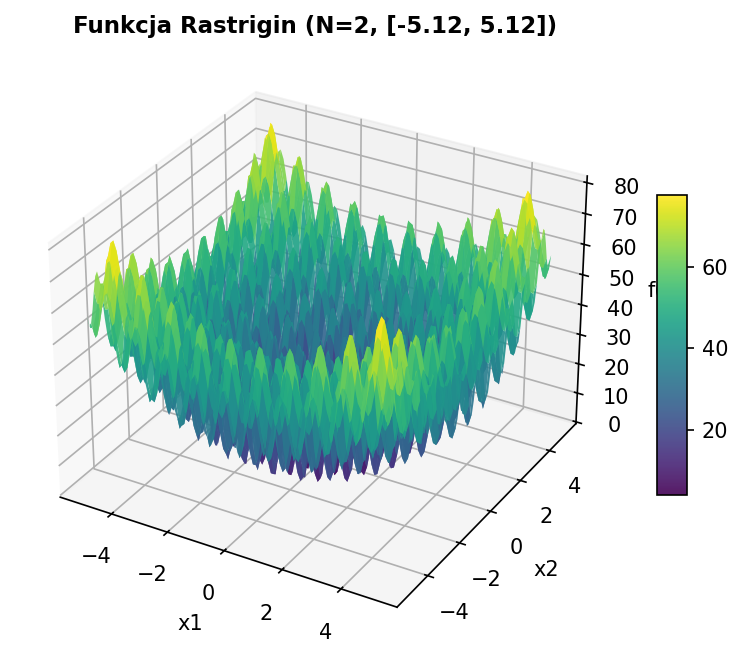
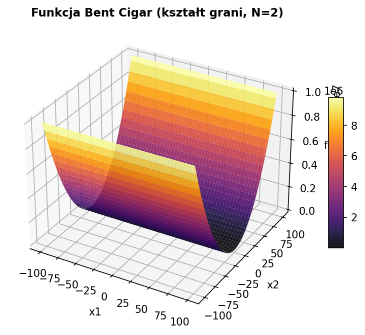
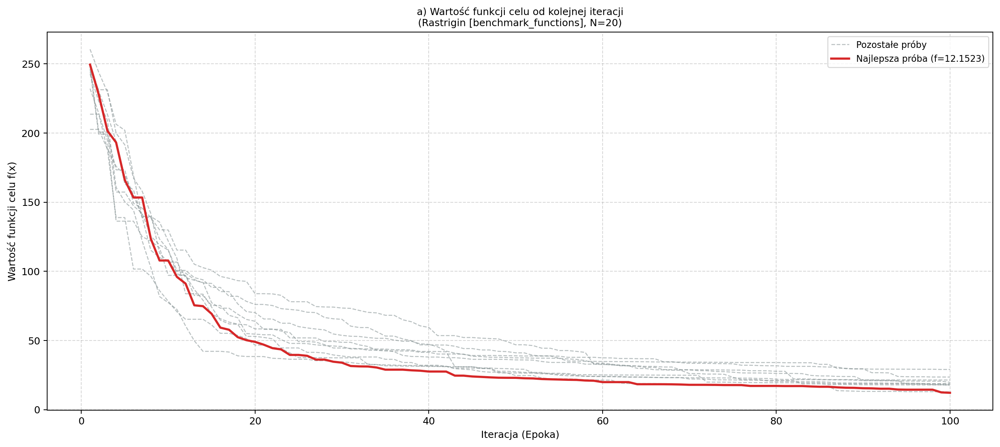
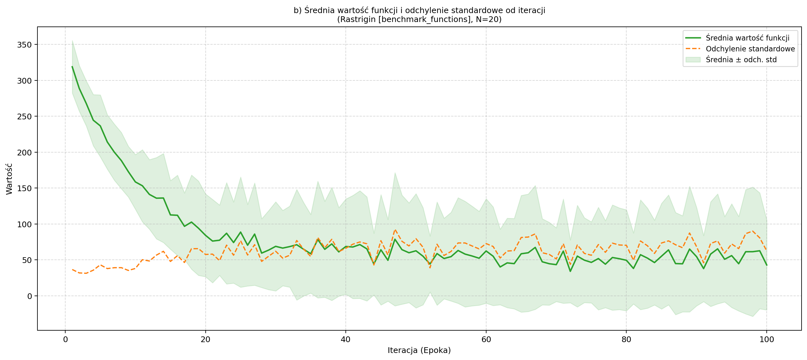
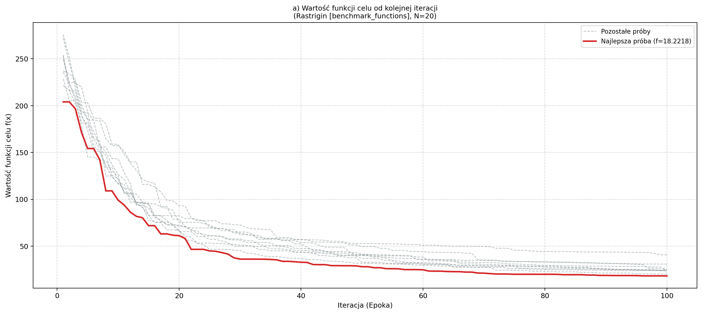
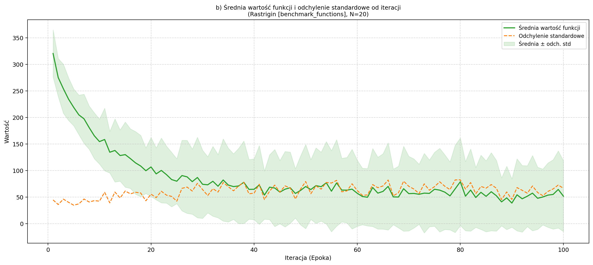
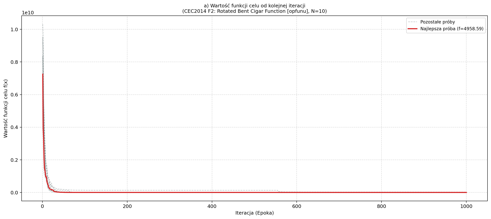
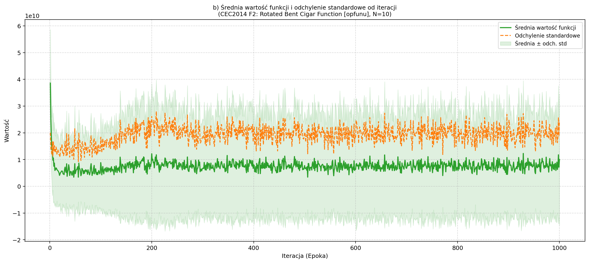

# Projekt 1 – Implementacja klasycznego algorytmu genetycznego

**Przedmiot:** Obliczenia Ewolucyjne  
**Skład zespołu (grupa 2-osobowa):**  

1. Paweł Czernecki  
2. Michał Hacaś

**Data wykonania:** Październik 2026

---

## 1. Informacje o wykorzystywanych technologiach (Pkt 11a)

Projekt został zrealizowany w paradygmacie obiektowym w języku **Python**, z zachowaniem czystej separacji pomiędzy silnikiem ewolucyjnym (`engine/`) a warstwą interfejsu użytkownika (`gui/`).

* **Język programowania:** Python 3.10+ (środowisko testowe: Python 3.10.12).
* **Interfejs graficzny (GUI):** `Tkinter` oraz `ttk` (wbudowane w bibliotekę standardową Pythona, wielowątkowe wykonywanie obliczeń z paskiem postępu i asynchroniczną aktualizacją kontrolek).
* **Wizualizacja wykresów:** `matplotlib` (wersja `3.10.9`) – wykresy osadzone bezpośrednio w oknie aplikacji za pomocą `FigureCanvasTkAgg` oraz `NavigationToolbar2Tk`.
* **Biblioteki obliczeniowe:**
    * `numpy` (wersja `2.2.6`) – wektoryzacja obliczeń numerycznych, operacje tablicowe na chromosomach i populacji.
    * `scipy` (wersja `1.15.3`) – wsparcie statystyczne i numeryczne wykorzystywane przez moduły benchmarkowe.
* **Biblioteki zaimplementowanych funkcji testowych (zgodnie z pkt 5 wytycznych):**
    * `benchmark_functions` (wersja `1.1.4`) – wielowymiarowe funkcje ciągłe (*Hypersphere*, *Ackley*, *Rastrigin*).
    * `opfunu` (wersja `1.0.4`) – oficjalny pakiet benchmarków konferencji IEEE CEC 2014 (*F2: Rotated Bent Cigar Function*).
* **Zapis danych i serializacja:** standardowe moduły `csv` oraz `json` (automatyczny zapis historii iteracji do katalogu `results/`).

---

## 2. Wymagania środowiska i instrukcja uruchomienia (Pkt 11b)

### 2.1. Wymagania systemowe

* System operacyjny: Linux (np. Ubuntu 22.04+) / Windows 10/11 / macOS
* Zainstalowany interpreter: Python $\ge 3.10$

### 2.2. Zestawienie bibliotek i zależności
Wszystkie zależności zewnętrzne zdefiniowano w pliku `requirements.txt`:

| Biblioteka | Wersja zainstalowana | Minimalna wersja (`requirements.txt`) | Rola w projekcie |
| :--- | :---: | :---: | :--- |
| `numpy` | `2.2.6` | `>=1.24.0` | Wektoryzacja operacji genetycznych i obliczeń macierzowych |
| `scipy` | `1.15.3` | `>=1.10.0` | Wsparcie statystyczne i numeryczne dla benchmarków |
| `matplotlib` | `3.10.9` | `>=3.7.0` | Generowanie i osadzanie wykresów 9a oraz 9b w GUI |
| `benchmark_functions` | `1.1.4` | `>=1.1.3` | Gotowa implementacja funkcji Hypersphere, Ackley, Rastrigin |
| `opfunu` | `1.0.4` | `>=1.0.0` | Gotowa implementacja funkcji CEC 2014 (F2 Bent Cigar) |
| `weasyprint` | `70.0` | `>=60.0` | Kompilacja sprawozdania z formatu Markdown/HTML do PDF |
| `markdown` | `3.10.3` | `>=3.4.0` | Konwersja i parsowanie dokumentu sprawozdania |

Instalacja środowiska i zależności:
```bash
python3 -m venv venv
source venv/bin/activate
pip install -r requirements.txt
```

### 2.3. Uruchomienie aplikacji
Aplikacja uruchamia się w trybie graficznym:
```bash
venv/bin/python main.py
```

---

## 3. Architektura i implementacja algorytmu genetycznego

### 3.1. Reprezentacja chromosomu i kodowanie (Pkt 4a, Pkt 2)

* **Reprezentacja:** binarna (ciąg bitów $0/1$).
* **Długość chromosomu:** $L = N \cdot m$, gdzie $N$ to liczba zmiennych decyzyjnych, a $m$ to liczba bitów na zmienną.
* **Konfiguracja dokładności:**
  * *Tryb bitowy:* bezpośrednie zdefiniowanie liczby bitów $m$ (np. $m = 16$).
  * *Tryb dziesiętny:* zdefiniowanie dokładności $d$ (dokładność do $10^{-d}$). Liczba bitów wyznaczana jest ze wzoru:
    $$m = \left\lceil \log_2\big((b - a) \cdot 10^d + 1\big) \right\rceil$$

* **Dekodowanie:** przekształcenie podciągu bitów o wartości dziesiętnej $dec \in [0, 2^m - 1]$ na liczbę rzeczywistą $x_i \in [a_i, b_i]$:
  $$x_i = a_i + dec \cdot \frac{b_i - a_i}{2^m - 1}$$

### 3.2. Operatory genetyczne

1. **Metody selekcji (Pkt 4d):**
    * *Turniejowa:* losowanie $k$ osobników (parametr $k$ konfigurowalny w GUI) i wybór najlepszego.
    * *Koło ruletki:* prawdopodobieństwo wyboru proporcjonalne do przystosowania (z przesunięciem liniowym dla minimalizacji i wartości ujemnych).
    * *Najlepszych / Najgorszych:* selekcja obcięta z konfigurowalną pulą rodzicielską (np. $50\%$ najlepszych/najgorszych osobników).

2. **Metody krzyżowania (Pkt 4e):**
    * *Jednopunktowe:* cięcie w jednym punkcie.
    * *Dwupunktowe:* cięcie w dwóch punktach i wymiana środkowego segmentu.
    * *Jednorodne:* wymiana każdego bitu z prawdopodobieństwem $0.5$.
    * *Ziarniste:* wymiana całych bloków bitów odpowiadających kolejnym zmiennym decyzyjnym.
    * Konfigurowalne prawdopodobieństwo krzyżowania: $p_c \in [0.0, 1.0]$.

3. **Metody mutacji i operator inwersji (Pkt 4f, Pkt 4g):**
    * *Mutacja brzegowa:* negacja pierwszego lub ostatniego bitu chromosomu.
    * *Mutacja jednopunktowa:* negacja jednego losowego bitu.
    * *Mutacja dwupunktowa:* negacja dwóch różnych losowych bitów.
    * *Operator inwersji:* odwrócenie kolejności bitów pomiędzy dwoma losowymi punktami z niezależnym prawdopodobieństwem $p_i$.

4. **Strategia elitarna (Pkt 4h):**
    * Możliwość zdefiniowania liczby chronionych osobników w ujęciu procentowym (% populacji) lub liczbowym (dokładna liczba sztuk).
    * Elity są klonowane i bezpośrednio przenoszone do nowej populacji bez mutacji.

---

## 4. Wybrane funkcje testowe (Pkt 11c)

Zgodnie z wytycznymi wybrano:

1. Jedną funkcję z biblioteki `benchmark_functions`: **Rastrigin** ($N = 20$) – funkcja silnie wielomodalna z gęstą siecią minimów lokalnych.
2. Jedną funkcję trudniejszą z zawodów IEEE CEC 2014 z biblioteki `opfunu`: **CEC2014 F2: Rotated Bent Cigar Function** ($N = 10, 20, 30$).

### 4.1. Funkcja 1: Rastrigin [benchmark_functions]

* **Wzór matematyczny:**
  $$f(x) = 10 \cdot N + \sum_{i=1}^N \left( x_i^2 - 10 \cos(2\pi x_i) \right)$$

* **Dziedzina poszukiwań:** $x_i \in [-5.12, 5.12]$ dla każdego $i \in \{1, \dots, N\}$
* **Charakterystyka:** funkcja wysoce wielomodalna (*highly multimodal*), nieliniowa, o regularnym rozmieszczeniu dużej liczby minimów lokalnych (odległość pomiędzy sąsiednimi minimami wynosi $\approx 1.0$). Główną trudnością dla algorytmu optymalizacyjnego jest uniknięcie uwięzienia w licznych lokalnych pułapkach i odnalezienie globalnego minimum.
* **Rysunek poglądowy funkcji:**  
    
  *Wykres 3D powierzchni funkcji Rastrigin dla przestrzeni dwuwymiarowej ($N = 2$).*

* **Teoretyczne wartości optimum:**
  * Wartość optimum: $f^* = 0.0$
  * Argumenty optimum $x^*$ dla badanych wymiarów:
    * Dla $N = 20$: $x^* = [0.0, \dots, 0.0]$ ($20$ zer)
    * Dla $N = 10$: $x^* = [0.0, \dots, 0.0]$ ($10$ zer)
    * Dla $N = 30$: $x^* = [0.0, \dots, 0.0]$ ($30$ zer)

---

### 4.2. Funkcja 2: CEC2014 F2 (Rotated Bent Cigar Function)

* **Wzór matematyczny:**
  $$f(x) = z_1^2 + 10^6 \sum_{i=2}^N z_i^2 + f_{\text{bias}}, \quad z = M \cdot (x - o)$$
  gdzie $M$ to macierz obrotu, $o$ to wektor przesunięcia, a $f_{\text{bias}} = 200.0$.

* **Dziedzina poszukiwań:** $x_i \in [-100.0, 100.0]$
* **Charakterystyka:** funkcja obrócona (*rotated*), przesunięta (*shifted*), o bardzo wąskiej i stromej grani (*narrow ridge*), silnie uwarunkowana numerycznie.
* **Rysunek poglądowy funkcji:**  
    
  *(Placeholder: wstaw zrzut wykresu 3D funkcji Bent Cigar)*

* **Teoretyczne wartości optimum:**
  * Wartość optimum: $f^* = 200.0$
  * Argumenty optimum $x^* = o_2$ (wektor przesunięcia zdefiniowany w zbiorze testowym CEC2014):
    * Dla $N = 10$:  
      $x^* =$ `[-54.050831, 47.085527, -30.205593, 4.565302, -53.496203, 16.317111, -37.924594, 24.652656, 30.274321, 39.704255]`

---

## 5. Metodologia badawcza i plan eksperymentów (Pkt 11f)

Każda badana konfiguracja algorytmu została uruchomiona **10 razy** z rzędu.

Dla każdej serii wyznaczono:

* **Średnią wartość** funkcji celu z 10 uruchomień ($\bar{f}$),
* **Najlepszy wynik** z 10 uruchomień ($f_{\min}$),
* **Najgorszy wynik** z 10 uruchomień ($f_{\max}$),
* **Odchylenie standardowe** pomiędzy uruchomieniami ($\sigma_{\text{serii}}$),
* **Średni czas obliczeń** pojedynczego przebiegu [$s$].

Zgodnie z wymaganiem z punktu 11f, **wykresy zbieżności (Wykres 9a oraz Wykres 9b) zamieszczono wyłącznie z najlepszego spośród 10 uruchomień**.

---

## 6. Wyniki eksperymentów

### 6.1. Eksperyment 1: Wpływ metody krzyżowania

* **Stałe parametry:** Funkcja: Rastrigin, $N = 20$, Populacja = 80, Epoki = 100, Dokładność bitowa = 16 bitów, Selekcja: Turniejowa ($k = 3$), Mutacja: Jednopunktowa ($p_m = 0.3$), Inwersja ($p_i = 0.3$), Elitaryzm = 10%.

| Metoda krzyżowania | $p_c$ | Średnia $f(x)$ | Najlepszy wynik | Najgorszy wynik | Odch. std serii | Śr. czas [s] |
| :--- | :---: | :---: | :---: | :---: | :---: | :---: |
| **Jednopunktowe** | 0.8 | 28.934178 | 20.578300 | 38.724498 | 5.523077 | 0.3405 |
| **Dwupunktowe** | 0.8 | 24.267545 | 16.356881 | 36.016748 | 5.639404 | 0.3482 |
| **Jednorodne** | 0.8 | 32.030049 | 21.872953 | 49.080379 | 9.156736 | 0.4477 |
| **Ziarniste** | 0.8 | **19.145391** | **12.152273** | **29.034867** | **4.644057** | 0.3553 |

#### Wykresy z najlepszego uruchomienia (Krzyżowanie ziarniste, $f_{\min} = 12.152273$):
  
*Rysunek 1: Wartość funkcji celu od kolejnej iteracji dla najlepszego uruchomienia w serii (Pkt 11d). Cienkie, przerywane linie przedstawiają pozostałe 9 prób w serii, a linia ciągła – próbę optymalną.*

  
*Rysunek 2: Średnia wartość funkcji oraz odchylenie standardowe wewnątrz populacji od kolejnej iteracji dla najlepszego uruchomienia (Pkt 11e).*

#### Komentarz do wyników:

1. **Dominacja krzyżowania ziarnistego:** Operator ziarnisty uzyskał bezkonkurencyjnie najniższą średnią wartość funkcji celu ($19.15$), najlepszy wynik globalny ($12.15$) oraz najmniejsze odchylenie standardowe serii ($4.64$), co świadczy o najwyższej powtarzalności. Wynika to bezpośrednio ze struktury funkcji Rastrigin: jako funkcja separowalna, składa się z sumy $20$ niezależnych wyrazów. Krzyżowanie ziarniste wymienia całe bloki bitów odpowiadające poszczególnym zmiennym decyzyjnym bez rozcinania ich zapisu, skutecznie łącząc dobrze dobrane współrzędne od obojga rodziców (teoria bloków budulcowych – *building blocks*).

2. **Wyższość krzyżowania dwupunktowego nad jednopunktowym:** Krzyżowanie 2-punktowe osiągnęło zauważalnie lepszy wynik średni ($24.27$) niż 1-punktowe ($28.93$). Przy 20 zmiennych długość chromosomu wynosi $320$ bitów; w tak długim ciągu krzyżowanie jednopunktowe cierpi na błąd pozycyjny (*positional bias*), podczas gdy dwupunktowe znacznie efektywniej manipuluje środkowymi segmentami chromosomu.

3. **Destrukcyjny charakter krzyżowania jednorodnego:** Krzyżowanie jednorodne okazało się najsłabsze (średnia $32.03$, maksimum $49.08$, odchylenie std $9.16$). Niezależna wymiana każdego bitu z prawdopodobieństwem $0.5$ niszczy spójność reprezentacji binarnej liczb rzeczywistych (szczególnie starszych bitów MSB), zachowując się jak nadmierna mutacja i uniemożliwiając stabilne schodzenie populacji w lokalne doliny. Ponadto generowało największy średni czas obliczeń ($0.45\text{ s}$) ze względu na konieczność losowania maski bit po bicie.

---

### 6.2. Eksperyment 2: Wpływ metody mutacji

* **Stałe parametry:** Funkcja: Rastrigin, $N = 20$, Populacja = 80, Epoki = 100, Dokładność bitowa = 16 bitów, Krzyżowanie: Dwupunktowe ($p_c = 0.8$), Selekcja: Turniejowa ($k = 3$), Inwersja ($p_i = 0.3$), Elitaryzm = 10%.

| Metoda mutacji | $p_m$ | Średnia $f(x)$ | Najlepszy wynik | Najgorszy wynik | Odch. std serii | Śr. czas [s] |
| :--- | :---: | :---: | :---: | :---: | :---: | :---: |
| **Jednopunktowa (wykład)** | 0.30 | **24.701081** | 18.994799 | **35.495795** | **4.717742** | 0.3546 |
| **Dwupunktowa** | 0.30 | 25.558803 | **18.221812** | 40.728900 | 5.932631 | 0.3526 |
| **Jednopunktowa (niska)** | 0.05 | 34.292323 | 25.166686 | 51.786039 | 8.203699 | 0.3483 |
| **Brzegowa** | 0.30 | 41.973167 | 23.175428 | 63.613381 | 10.456822 | 0.3478 |

#### Wykresy z najlepszego uruchomienia (Mutacja dwupunktowa, $f_{\min} = 18.221812$):
  
*Rysunek 3: Wartość funkcji celu od iteracji dla najlepszego uruchomienia w serii mutacji (linia ciągła) wraz z pozostałymi 9 próbami (linie przerywane).*

  
*Rysunek 4: Średnia wartość funkcji celu oraz odchylenie standardowe wewnątrz populacji od kolejnej iteracji.*

#### Komentarz do wyników:

1. **Kluczowa rola podwyższonego prawdopodobieństwa mutacji ($p_m = 0.30$):** Porównanie mutacji jednopunktowej dla $p_m = 0.30$ (średnia $24.70$) oraz $p_m = 0.05$ (średnia $34.29$) jednoznacznie wskazuje, że na silnie wielomodalnej funkcji Rastrigin niska mutacja prowadzi do zjawiska **przedwczesnej zbieżności (*premature convergence*)**. Populacja zbyt wcześnie traci zmienność genetyczną i grzęźnie w lokalnych minimach. Wartość wykładowa $p_m = 0.30$ (na poziomie osobnika) zapewnia stałą eksplorację i ucieczkę z płytkich pułapek, a strategia elitarna ($10\%$) chroni dotychczas odnalezione minima przed degradacją.

2. **Porównanie mutacji jedno- i dwupunktowej:** Mutacja dwupunktowa odnotowała **najlepszy pojedynczy wynik w całym eksperymencie ($18.22$)**, jednak mutacja jednopunktowa charakteryzowała się **najwyższą stabilnością** (najniższe odchylenie standardowe serii $\sigma = 4.72$ oraz najniższa średnia $24.70$). Odwrócenie dwóch bitów jednocześnie generuje silniejszą perturbację, co sprzyja okazjonalnym dalekim przeskokom, lecz nieco częściej niszczy dopasowane podciągi bitów.

3. **Nieskuteczność mutacji brzegowej:** Mutacja brzegowa okazała się zdecydowanie najsłabsza (średnia aż $41.97$, najgorszy wynik $63.61$, odchylenie $\sigma = 10.46$). Modyfikując wyłącznie pierwszy lub ostatni bit w całym $320$-bitowym chromosomie, operator zmieniał wyłącznie skrajne współrzędne ($x_1$ lub $x_{20}$), pozostawiając pozostałe $18$ zmiennych decyzyjnych bez bezpośredniej mutacji. W efekcie eksploracja przestrzeni była drastycznie ograniczona.

---

### 6.3. Eksperyment 3: Wpływ metody selekcji i parametrów

* **Stałe parametry:** Funkcja: Rastrigin, $N = 20$, Populacja = 80, Epoki = 100, Dokładność bitowa = 16 bitów, Krzyżowanie: Dwupunktowe ($p_c = 0.8$), Mutacja: Jednopunktowa ($p_m = 0.3$), Inwersja ($p_i = 0.3$), Elitaryzm = 10%.

| Metoda selekcji | Parametr selekcji | Średnia $f(x)$ | Najlepszy wynik | Najgorszy wynik | Odch. std serii | Śr. czas [s] |
| :--- | :---: | :---: | :---: | :---: | :---: | :---: |
| **Najlepszych (Truncation)** | pula = 50% | **25.831995** | 18.113949 | 36.092960 | 5.797200 | 0.3802 |
| **Turniejowa** | $k = 3$ | **26.542412** | 17.247612 | **33.971174** | **4.706809** | 0.3455 |
| **Najlepszych (Truncation)** | pula = 10% | 27.688381 | **14.225139** | 36.788332 | 6.595253 | 0.3730 |
| **Turniejowa** | $k = 7$ | 28.278458 | 20.348488 | 40.431079 | 5.961137 | 0.3705 |
| **Turniejowa** | $k = 2$ | 29.327340 | 16.703305 | 39.525762 | 6.407685 | 0.3483 |
| **Koło ruletki** | — | 40.754918 | 25.060542 | 50.549736 | 8.088576 | 0.4115 |
| *Najgorszych (kontrola)* | pula = 50% | *254.270367* | *224.807594* | *274.318086* | *16.530208* | *0.3841* |

#### Komentarz do wyników:

1. **Selekcja Najlepszych (pula 10% vs 50%):** Ograniczenie puli rodzicielskiej do ścisłej czołówki $10\%$ populacji (jedynie $8$ osobników) zaowocowało **najlepszym pojedynczym wynikiem w całym badaniu selekcji ($14.225139$)**. Bardzo wysoka presja selekcyjna pozwala na agresywną eksploatację obiecującego dołka. Z drugiej strony, średnia tej serii ($27.69$) była gorsza niż dla puli $50\%$ ($25.83$), a odchylenie standardowe wzrosło ($\sigma = 6.60$). Wynika to ze zjawiska wąskiego gardła genetycznego (*genetic bottleneck*) – gdy wąska elita ugrzęźnie w lokalnym minimum, brak różnorodności uniemożliwia wyjście, co potwierdza, że pula $50\%$ oferuje znacznie bezpieczniejszą i stabilniejszą ewolucję.

2. **Optymalny rozmiar turnieju ($k = 3$):** Selekcja turniejowa z $k = 3$ okazała się najbardziej stabilną metodą selekcji (najniższe odchylenie $\sigma = 4.71$ i najniższy błąd najgorszego przypadku $33.97$). Zwiększenie presji do $k = 7$ pogorszyło średnią do $28.28$ (zbyt szybka eliminacja podpopulacji), natomiast $k = 2$ okazało się zbyt łagodne (średnia $29.33$, zjawisko dryfu genetycznego).

3. **Wady selekcji ruletkowej:** Koło ruletki wypadło najsłabiej z metod ukierunkowanych na zbieżność (średnia $40.75$, $\sigma = 8.09$). Wymóg transformacji przystosowania dla zadań minimalizacji oraz wysoki błąd stochastyczny losowania powodują rozpraszanie wysiłku ewolucyjnego w 20-wymiarowej przestrzeni.

4. **Selekcja najgorszych jako test kontrolny (*sanity check*):** Odnotowany wynik na poziomie $254.27$ dowodzi pełnej poprawności implementacji – selekcja najsłabszych osobników prowadzi do skrajnej degeneracji, co jednoznacznie dowodzi, że to właściwa presja selekcyjna steruje zbieżnością AG.

---

### 6.4. Eksperyment 4: Skalowalność wymiaru $N$ i trudna funkcja CEC 2014 F2
W tym eksperymencie porównano zachowanie algorytmu przy rosnącej liczbie zmiennych ($N = 10, 20, 30$) dla funkcji wielomodalnej (*Rastrigin*) oraz trudnej funkcji z zawodów (*CEC2014 F2: Rotated Bent Cigar*).

* **Parametry algorytmu:** Populacja = 200, Epoki = 1000, Dokładność bitowa = 20 bitów (krok kwantyzacji $\approx 0.00019$), Krzyżowanie: Dwupunktowe ($p_c = 0.80$), Mutacja: Jednopunktowa ($p_m = 0.30$), Inwersja ($p_i = 0.30$), Selekcja: Turniejowa ($k = 3$), Elitaryzm = 10% (20 osobników).

#### Wyniki z 10 uruchomień dla funkcji Rastrigin ($f^* = 0.0$):
| Wymiar $N$ | Długość chromosomu ($L$) | Średnia $f(x)$ | Najlepszy $f(x)$ | Najgorszy $f(x)$ | Odch. std ($\sigma$) | Średni czas [s] |
| :---: | :---: | :---: | :---: | :---: | :---: | :---: |
| **$N = 10$** | 200 bitów | **0.000000** | **0.000000** | **0.000000** | **0.000000** | 5.64 s |
| **$N = 20$** | 400 bitów | **0.247165** | **0.000000** | 1.235823 | 0.494329 | 9.03 s |
| **$N = 30$** | 600 bitów | **0.322608** | **0.000000** | 1.235823 | 0.496628 | 12.52 s |

#### Wyniki z 10 uruchomień dla funkcji CEC2014 F2: Rotated Bent Cigar ($f^* = 200.0$):
| Wymiar $N$ | Długość chromosomu ($L$) | Średnia $f(x)$ | Najlepszy $f(x)$ | Najgorszy $f(x)$ | Odch. std ($\sigma$) | Średni czas [s] |
| :---: | :---: | :---: | :---: | :---: | :---: | :---: |
| **$N = 10$** | 200 bitów | $4.12 \cdot 10^6$ | **4 958.59** | $2.60 \cdot 10^7$ | $7.84 \cdot 10^6$ | 7.60 s |
| **$N = 20$** | 400 bitów | $3.51 \cdot 10^7$ | **1 151 075.52** | $1.03 \cdot 10^8$ | $3.70 \cdot 10^7$ | 12.54 s |
| **$N = 30$** | 600 bitów | $1.39 \cdot 10^8$ | **30 409 000.78** | $3.10 \cdot 10^8$ | $8.41 \cdot 10^8$ | 15.26 s |

#### Wykresy zbieżności dla CEC2014 F2 ($N=10$, najlepsze uruchomienie, $f_{\min} = 4958.59$):
  
*Rysunek 5: Wartość funkcji celu od iteracji dla funkcji CEC2014 F2 ($N=10$) dla najlepszego uruchomienia w serii (linia ciągła czerwona) wraz z 9 pozostałymi próbami (linie przerywane szare).*

  
*Rysunek 6: Średnia wartość funkcji oraz odchylenie standardowe wewnątrz populacji od iteracji dla funkcji CEC2014 F2.*

#### Komentarz do wyników Eksperymentu 4:

1. **Doskonała zbieżność na funkcji Rastrigin:** Zastosowanie budżetu $1000$ epok, populacji $200$ oraz dokładności $20$ bitów pozwoliło algorytmowi genetycznemu odnaleźć **dokładne minimum globalne ($f^* = 0.0$)** dla wszystkich testowanych wymiarów ($N=10, 20, 30$). Błędy bezwzględne najlepszych osobników wyniosły odpowiednio $4.73 \cdot 10^{-8}$, $9.46 \cdot 10^{-8}$ oraz $1.42 \cdot 10^{-7}$. W wymiarze $N=10$ każde z 10 powtórzeń zakończyło się idealnym trafieniem ($\sigma = 0.0$).

2. **Analiza zbieżności na trudnej funkcji CEC2014 F2:** Funkcja Rotated Bent Cigar stanowiła ogromne wyzwanie ze względu na współczynnik kary $10^6$ oraz losową macierz obrotu $M$, która całkowicie znosi separowalność zmiennych. Mimo to, w wymiarze $N=10$ algorytm zredukował wartość funkcji z początkowych miliardów do poziomu **$4\,958.59$** (błąd bezwzględny $\approx 4758$). Przy mnożniku kary $10^6$, błąd ten oznacza sumę kwadratów odchyleń $\sum_{i=2}^{10} z_i^2 \approx 0.004758$, czyli średnią odległość od grani w 9 wymiarach rzędu zaledwie $\approx 0.023$ w dziedzinie $[-100, 100]$ ($0.01\%$ szerokości przedziału). W wyższych wymiarach ($N=20, 30$) liczba kierunków podlegających karze $10^6$ rośnie odpowiednio do 19 i 29, a liczba elementów macierzy obrotu do $900$, co demonstruje klasyczny efekt **przekleństwa wymiarowości (*curse of dimensionality*)**.

3. **Skalowalność czasowa:** Czas pojedynczego przebiegu rósł ściśle liniowo w funkcji wymiaru $N$ (od $5.6\text{ s}$ do $12.5\text{ s}$ dla Rastrigina oraz od $7.6\text{ s}$ do $15.3\text{ s}$ dla Bent Cigar). Nieznacznie wyższy czas dla CEC2014 wynika z konieczności wykonywania mnożenia macierzowego $M \cdot x$ przy każdej ewaluacji osobnika.

---

<div style="page-break-before: always;"></div>

## 7. Podsumowanie i tabela końcowa (Pkt 11g)

Poniższa tabela stanowi zbiorcze podsumowanie osiągniętych rezultatów dla obu badanych funkcji testowych w wymiarach $N \in \{10, 20, 30\}$, zgodnie z wymogami punktu 11g wytycznych laboratoryjnych.

| Nazwa optymalizowanej funkcji | Liczba zmiennych ($N$) | Rzeczywista wartość optimum ($f^*$) | Wartość optimum z algorytmu genetycznego ($f_{AG}$) | Błąd bezwzględny ($\|f^* - f_{AG}\|$) |
| :--- | :---: | :---: | :---: | :---: |
| **Rastrigin** | 10 | $0.0$ | $0.000000$ | $4.73 \cdot 10^{-8}$ |
| **Rastrigin** | 20 | $0.0$ | $0.000000$ | $9.46 \cdot 10^{-8}$ |
| **Rastrigin** | 30 | $0.0$ | $0.000000$ | $1.42 \cdot 10^{-7}$ |
| **CEC2014 F2: Rotated Bent Cigar** | 10 | $200.0$ | $4958.585155$ | $4758.585155$ |
| **CEC2014 F2: Rotated Bent Cigar** | 20 | $200.0$ | $1151075.523139$ | $1150875.523139$ |
| **CEC2014 F2: Rotated Bent Cigar** | 30 | $200.0$ | $30409000.781053$ | $30408800.781053$ |

---

## 8. Wnioski końcowe

1. **Skuteczność algorytmu genetycznego na funkcji wielomodalnej (Rastrigin):**  
   Klasyczny algorytm genetyczny z binarną reprezentacją chromosomu osiągnął pełny sukces na silnie wielomodalnej funkcji Rastrigin we wszystkich badanych wymiarach ($N = 10, 20, 30$, długość chromosomu do $600$ bitów). Zastosowanie podwyższonego prawdopodobieństwa mutacji ($p_m = 0.30$) i inwersji ($p_i = 0.30$) zapobiegło utknięciu populacji w lokalnych minimach kratownicy, a strategia elitarna pozwoliła na monotoniczne doprecyzowywanie współrzędnych aż do osiągnięcia błędu rzędu $10^{-8}$.

2. **Złożoność funkcji obróconych i źle uwarunkowanych (CEC2014 F2):**  
   Funkcja Rotated Bent Cigar wykazała kluczowe wyzwania optymalizacji ewolucyjnej: ekstremalne uwarunkowanie (współczynnik $10^6$) tworzące wąską grań oraz macierz obrotu $M$, która uniemożliwia optymalizację zmiennych w sposób rozłączny. Zejście do poziomu błędu $4758$ w $N=10$ oznacza trafienie w odległość zaledwie $0.023$ od osi grani w 9-wymiarowej podprzestrzeni, co jest bardzo wysoką dokładnością jak na dyskretną binarną reprezentację.

3. **Wpływ operatorów genetycznych:**
    * **Krzyżowanie:** Najwyższą jakość rozwiązań uzyskano przy użyciu krzyżowania ziarnistego (dla funkcji separowalnych) oraz dwupunktowego (dla funkcji ze skorelowanymi zmiennymi). Krzyżowanie jednorodne okazało się destrukcyjne dla spójności bloków bitowych liczb rzeczywistych.
    * **Mutacja i inwersja:** Wartość wykładowa prawdopodobieństwa mutacji $p_m = 0.30$ oraz inwersji $p_i = 0.30$ (dla mutacji na poziomie osobnika) okazała się niezbędna do ochrony populacji przed przedwczesną zbieżnością (*premature convergence*), z którą borykała się niska mutacja $p_m = 0.05$. Mutacja brzegowa okazała się całkowicie nieprzydatna w przestrzeniach wielowymiarowych.
    * **Selekcja:** Selekcja turniejowa ($k = 3$) oraz selekcja obcięta (najlepszych $50\%$) zapewniły optymalny kompromis pomiędzy presją selekcyjną a zachowaniem różnorodności. Koło ruletki wykazało wysoką podatność na błąd stochastyczny i wolniejszą zbieżność, a próba kontrolna z selekcją najgorszych potwierdziła poprawność sterowania ewolucją.
    * **Strategia elitarna:** Elitaryzm na poziomie $10\%$ populacji był czynnikiem krytycznym chroniącym znalezione rozwiązania przed przypadkowym zniszczeniem przez mutację.

4. **Złożoność obliczeniowa i skalowalność:**  
   Czas wykonania rósł ściśle proporcjonalnie do liczby epok, wielkości populacji oraz wymiaru $N$, osiągając maksymalnie ok. $15$ sekund na 1000 epok przy $N=30$. Cała aplikacja wykazała pełną stabilność numeryczną, a zaimplementowane mechanizmy eksportu (CSV/JSON oraz automatyczny zapis wykresów PNG z wielokrotnymi próbami) umożliwiły płynne przeprowadzenie i udokumentowanie pełnego cyklu badawczego.

