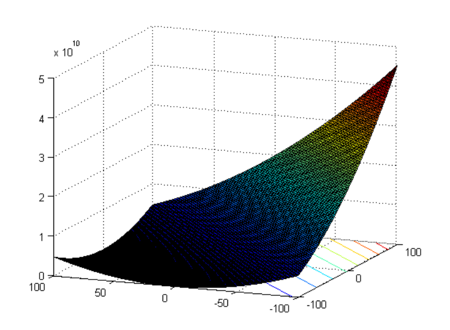
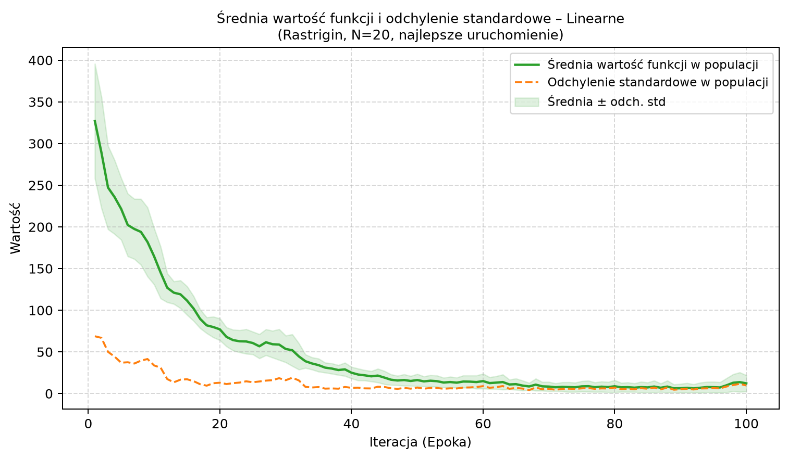
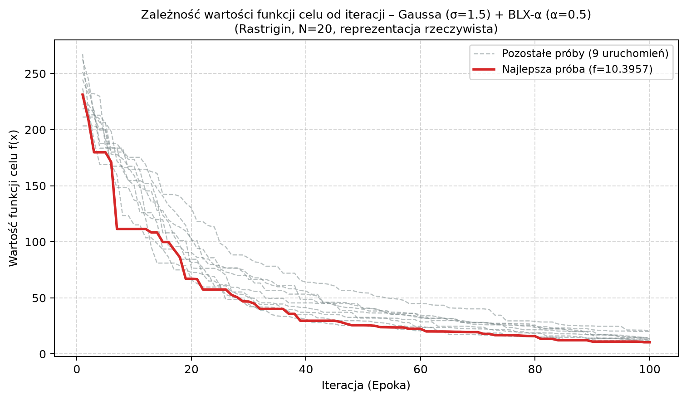
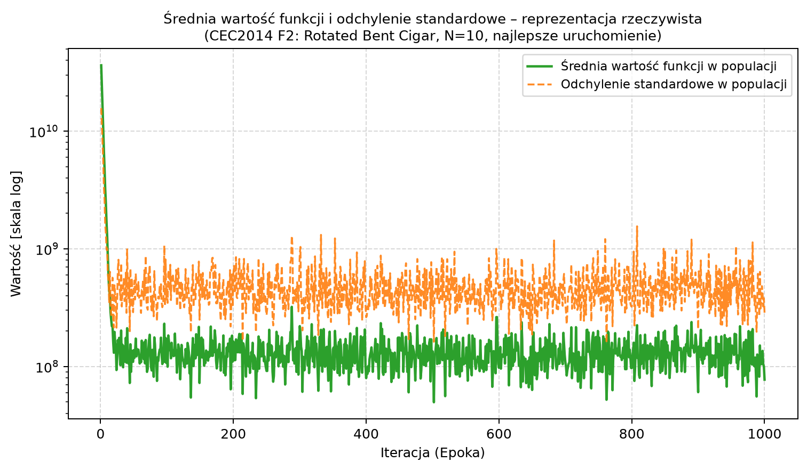

# Projekt 2 – Implementacja chromosomu rzeczywistego

**Przedmiot:** Obliczenia Ewolucyjne  
**Skład zespołu (grupa 2-osobowa):**  

1. Paweł Czernecki  
2. Michał Hacaś

**Data wykonania:** Listopad 2026

---

## 1. Informacje o wykorzystywanych technologiach

Projekt stanowi rozszerzenie aplikacji z Projektu 1. Silnik został rozbudowany o obsługę **reprezentacji rzeczywistej** chromosomu, ciągłe operatory krzyżowania (arytmetyczne, linearne-1, linearne-2, BLX-$\alpha$, BLX-$\alpha\beta$, uśredniające), dwie ciągłe metody mutacji (równomierną oraz Gaussa) i dynamiczne przełączanie między reprezentacją rzeczywistą i binarną w GUI.

* **Język programowania:** Python 3.10+ (środowisko testowe: Python 3.10.12).
* **Interfejs graficzny (GUI):** `Tkinter` oraz `ttk` (wbudowane w bibliotekę standardową Pythona, wielowątkowe wykonywanie obliczeń z paskiem postępu i asynchroniczną aktualizacją kontrolek).
* **Wizualizacja wykresów:** `matplotlib` (wersja `3.10.9`) – wykresy osadzone bezpośrednio w oknie aplikacji za pomocą `FigureCanvasTkAgg` oraz `NavigationToolbar2Tk`.
* **Biblioteki obliczeniowe:**
    * `numpy` (wersja `2.2.6`) – wektoryzacja obliczeń numerycznych, operacje tablicowe na chromosomach i populacji.
* **Biblioteki zaimplementowanych funkcji testowych:**
    * `benchmark_functions` (wersja `1.1.4`) – wielowymiarowe funkcje ciągłe (*Hypersphere*, *Ackley*, *Rastrigin*).
    * `opfunu` (wersja `1.0.4`) – oficjalny pakiet benchmarków konferencji IEEE CEC 2014 (*F2: Rotated Bent Cigar Function*).
* **Zapis danych i serializacja:** standardowe moduły `csv` oraz `json` (automatyczny zapis historii iteracji do katalogu `results/`).

---

## 2. Wymagania środowiska i instrukcja uruchomienia

### 2.1. Wymagania systemowe

* System operacyjny: Linux
* Zainstalowany interpreter: Python $\ge 3.10$

### 2.2. Zestawienie bibliotek i zależności
Wszystkie zależności zewnętrzne zdefiniowano w pliku `requirements.txt`:

| Biblioteka | Wersja | Rola w projekcie |
| :--- | :---: | :--- |
| `numpy` | `2.2.6` | Wektoryzacja operacji genetycznych i obliczeń macierzowych |
| `matplotlib` | `3.10.9` | Generowanie i osadzanie wykresów zbieżności w GUI |
| `benchmark_functions` | `1.1.4` | Gotowa implementacja funkcji Hypersphere, Ackley, Rastrigin |
| `opfunu` | `1.0.4` | Gotowa implementacja funkcji CEC 2014 (F2 Bent Cigar) |

Instalacja środowiska i zależności:
```bash
python3 -m venv venv
source venv/bin/activate
pip install -r requirements.txt
```

### 2.3. Uruchomienie aplikacji
Aplikacja uruchamia się w trybie graficznym:
```bash
venv/bin/python main.py
```

---

## 3. Wybrane funkcje testowe

Do badań wybrano dwie funkcje testowe o odmiennej charakterystyce:

1. Jedną funkcję z biblioteki `benchmark_functions`: **Rastrigin** ($N = 20$) – funkcja silnie wielomodalna z gęstą siecią minimów lokalnych.
2. Jedną funkcję trudniejszą z zawodów IEEE CEC 2014 z biblioteki `opfunu`: **CEC2014 F2: Rotated Bent Cigar Function** ($N = 10, 20, 30$).

### 3.1. Funkcja 1: Rastrigin [benchmark_functions]

* **Wzór matematyczny:**
  $$f(x) = 10 \cdot N + \sum_{i=1}^N \left( x_i^2 - 10 \cos(2\pi x_i) \right)$$

* **Dziedzina poszukiwań:** $x_i \in [-5.12, 5.12]$ dla każdego $i \in \{1, \dots, N\}$
* **Charakterystyka:** funkcja wysoce wielomodalna (*highly multimodal*), nieliniowa, o regularnym rozmieszczeniu dużej liczby minimów lokalnych (odległość pomiędzy sąsiednimi minimami wynosi $\approx 1.0$). Główną trudnością dla algorytmu optymalizacyjnego jest uniknięcie uwięzienia w licznych lokalnych pułapkach i odnalezienie globalnego minimum.
* **Rysunek poglądowy funkcji:**  
    
  *Wykres 3D powierzchni funkcji Rastrigin dla przestrzeni dwuwymiarowej ($N = 2$).*

* **Teoretyczne wartości optimum:**
  * Wartość optimum: $f^* = 0.0$
  * Argumenty optimum $x^*$ dla badanych wymiarów:
    * Dla $N = 20$: $x^* = [0.0, \dots, 0.0]$ ($20$ zer)
    * Dla $N = 10$: $x^* = [0.0, \dots, 0.0]$ ($10$ zer)
    * Dla $N = 30$: $x^* = [0.0, \dots, 0.0]$ ($30$ zer)

---

### 3.2. Funkcja 2: CEC2014 F2 (Rotated Bent Cigar Function)

* **Wzór matematyczny:**
  $$f(x) = z_1^2 + 10^6 \sum_{i=2}^N z_i^2 + f_{\text{bias}}, \quad z = M \cdot (x - o)$$
  gdzie $M$ to macierz obrotu, $o$ to wektor przesunięcia, a $f_{\text{bias}} = 200.0$.

* **Dziedzina poszukiwań:** $x_i \in [-100.0, 100.0]$
* **Charakterystyka:** funkcja obrócona (*rotated*), przesunięta (*shifted*), o bardzo wąskiej i stromej grani (*narrow ridge*), silnie uwarunkowana numerycznie.
* **Rysunek poglądowy funkcji:**  
    
  *Wykres 3D powierzchni funkcji Bent Cigar dla przestrzeni dwuwymiarowej ($N = 2$).*

* **Teoretyczne wartości optimum:**
  * Wartość optimum: $f^* = 200.0$
  * Argumenty optimum $x^* = o_2$ (wektor przesunięcia zdefiniowany w zbiorze testowym CEC2014):
    * Dla $N = 10$:  
      $x^* =$ `[-54.050831, 47.085527, -30.205593, 4.565302, -53.496203, 16.317111, -37.924594, 24.652656, 30.274321, 39.704255]`

---

## 4. Metodologia badawcza i plan eksperymentów

Każda badana konfiguracja algorytmu została uruchomiona **10 razy**.

Dla każdej serii wyznaczono:

* **Średnią wartość** funkcji celu z 10 uruchomień ($\bar{f}$),
* **Najlepszy wynik** z 10 uruchomień ($f_{\min}$),
* **Najgorszy wynik** z 10 uruchomień ($f_{\max}$),
* **Odchylenie standardowe** pomiędzy uruchomieniami ($\sigma_{\text{serii}}$),
* **Średni czas obliczeń** pojedynczego przebiegu [s].

Wykresy przebiegu ewolucji przedstawiają zależność wartości funkcji celu od kolejnej iteracji (najlepsza próba na tle pozostałych 9 uruchomień) oraz przebieg średniej wartości funkcji celu i odchylenia standardowego wewnątrz populacji dla najlepszego uruchomienia w danej serii.

---

## 5. Wyniki eksperymentów dla reprezentacji rzeczywistej

### 5.1. Eksperyment 1: Wpływ metody krzyżowania rzeczywistego

* **Stałe parametry:** Funkcja: Rastrigin, $N = 20$, Reprezentacja: Rzeczywista, Populacja = 80, Epoki = 100, Selekcja: Turniejowa ($k = 3$), Mutacja: Gaussa ($p_m = 0.30, \sigma = 0.5$), Elitaryzm = 10%, $p_c = 0.80$.

| Metoda krzyżowania | $p_c$ | Średnia $f(x)$ | Najlepszy wynik | Najgorszy wynik | Odch. std serii | Śr. czas [s] |
| :--- | :---: | :---: | :---: | :---: | :---: | :---: |
| **Arytmetyczne** | 0.8 | 19.113899 | 5.879955 | 32.809893 | 8.022653 | 0.1428 |
| **Linearne-1** | 0.8 | **11.410645** | **3.137567** | **16.717091** | **3.984448** | 0.2086 |
| **Linearne-2** | 0.8 | 37.454408 | 13.081599 | 56.346325 | 12.670932 | 0.1631 |
| **Mieszające typu alfa (BLX-$\alpha$, $\alpha=0.5$)** | 0.8 | 24.041170 | 12.536232 | 34.064169 | 6.101933 | 0.1627 |
| **Mieszające typu $\alpha$ i $\beta$ (BLX-$\alpha\beta$, $0.5, 0.25$)** | 0.8 | 22.834877 | 14.090566 | 35.811014 | 5.757205 | 0.1627 |
| **Uśredniające** | 0.8 | 16.157683 | 9.608655 | 23.323641 | 4.288544 | **0.1269** |

#### Wykresy z najlepszej serii (Krzyżowanie linearne-1, $f_{\min} = 3.137567$):
  
*Rysunek 1: Zależność wartości funkcji celu od kolejnej iteracji dla najlepszej serii w Eksperymencie 1 (krzyżowanie linearne-1). Linia ciągła czerwona oznacza najlepsze uruchomienie, a linie przerywane – pozostałe 9 prób.*

  
*Rysunek 2: Średnia wartość funkcji celu oraz odchylenie standardowe wewnątrz populacji w kolejnych iteracjach dla najlepszego uruchomienia (krzyżowanie linearne-1).*

#### Komentarz do wyników:

1. **Najwyższa skuteczność metody linearne-1:** Operator linearne-1 osiągnął zdecydowanie najlepszą średnią ($11.41$), najniższe minimum ($3.14$) oraz najniższe odchylenie standardowe serii ($3.98$). Wynika to z faktu, że w każdej parze rodziców bada trzy punkty ($Z, V, W$) i zatrzymuje dwa najlepsze.
2. **Porównanie z wariantem linearne-2:** Wariant linearne-2 był wyraźnie szybszy ($0.1631\text{ s}$ wobec $0.2086\text{ s}$), ponieważ korzysta z już wyznaczonych ocen rodziców zamiast wykonywać trzy ewaluacje potomstwa.
3. **Koszt czasowy oceny dodatkowych kandydatów:** Krzyżowanie linearne-1 było o około $30\text{–}60\%$ wolniejsze ($0.2086\text{ s}$) niż pozostałe operatory ($0.1269\text{–}0.1631\text{ s}$).
4. **Wyniki BLX-$\alpha$ i BLX-$\alpha\beta$ przy małej liczbie epok:** Dla $100$ epok operatory BLX-$\alpha$ (średnia $24.04$) oraz BLX-$\alpha\beta$ (średnia $22.83$) wypadły słabiej, ponieważ przy $\alpha = 0.5$ losują potomstwo z dość szerokiego przedziału wokół rodziców i wolniej zbiegają do minimum. Z kolei krzyżowanie uśredniające ($16.16$) i arytmetyczne ($19.11$) generują potomków pomiędzy rodzicami, dzięki czemu przy małej liczbie iteracji szybciej zawężają obszar poszukiwań.

---

### 5.2. Eksperyment 2: Wpływ metody mutacji oraz parametrów $\sigma$, $\alpha$ i $\beta$

* **Stałe parametry:** Funkcja: Rastrigin, $N = 20$, Reprezentacja: Rzeczywista, Populacja = 80, Epoki = 100, Selekcja: Turniejowa ($k = 3$), Elitaryzm = 10%, $p_c = 0.80$, $p_m = 0.30$.

| Konfiguracja mutacji i parametrów krzyżowania | Średnia $f(x)$ | Najlepszy wynik | Najgorszy wynik | Odch. std serii | Śr. czas [s] |
| :--- | :---: | :---: | :---: | :---: | :---: |
| **Mutacja równomierna + BLX-$\alpha$ ($\alpha=0.5$)** | 15.039189 | **8.493700** | 21.620620 | 3.781890 | **0.1591** |
| **Mutacja Gaussa ($\sigma=0.1$) + BLX-$\alpha$ ($\alpha=0.5$)** | 32.354820 | 12.949786 | 54.725794 | 12.124144 | 0.1661 |
| **Mutacja Gaussa ($\sigma=0.5$) + BLX-$\alpha$ ($\alpha=0.5$)** | 24.041170 | 12.536232 | 34.064169 | 6.101933 | 0.1622 |
| **Mutacja Gaussa ($\sigma=1.5$) + BLX-$\alpha$ ($\alpha=0.5$)** | **13.836396** | 10.395731 | **20.572631** | **3.486069** | 0.1621 |
| **Mutacja Gaussa ($\sigma=0.5$) + BLX-$\alpha$ ($\alpha=0.25$)** | 16.629337 | 9.662555 | 40.285106 | 8.723628 | 0.1623 |
| **Mutacja Gaussa ($\sigma=0.5$) + BLX-$\alpha\beta$ ($\alpha=0.5, \beta=0.25$)** | 22.834877 | 14.090566 | 35.811014 | 5.757205 | 0.1619 |

#### Wykresy z najlepszej konfiguracji (Mutacja Gaussa $\sigma = 1.5$ + BLX-$\alpha$ $\alpha = 0.5$):
  
*Rysunek 3: Wartość funkcji celu od iteracji dla najlepszej serii w Eksperymencie 2 (Mutacja Gaussa $\sigma=1.5$ + BLX-$\alpha$ $\alpha=0.5$).*

  
*Rysunek 4: Średnia wartość funkcji celu oraz odchylenie standardowe w populacji dla najlepszego uruchomienia w Eksperymencie 2.*

#### Komentarz do wyników:

1. **Wpływ parametru $\sigma$ w mutacji Gaussa:** Dla funkcji Rastrigin sąsiednie minima lokalne są oddalone od siebie o około $1.0$. Przy zbyt małym odchyleniu ($\sigma = 0.1$) zmiany są za małe, żeby wydostać się z minimów lokalnych, przez co algorytm w nich utyka (średnia $32.35$, odchylenie $12.12$). Zwiększenie $\sigma$ do $1.5$ poprawiło średni wynik ponad dwukrotnie – do **$13.84$**, a wyniki pomiędzy kolejnymi uruchomieniami były najbardziej powtarzalne (odchylenie $3.49$).
2. **Mutacja równomierna a mutacja Gaussa:** Mutacja równomierna dała najlepszy pojedynczy wynik w tym eksperymencie ($8.49$) oraz drugą najniższą średnią ($15.04$). Losowanie nowej wartości z całego zakresu $[-5.12, 5.12]$ pomaga wyjść z minimów lokalnych, ale mutacja Gaussa z $\sigma = 1.5$ okazała się bardziej stabilna i dała lepszą średnią, bo częściej modyfikuje rozwiązania w pobliżu ich aktualnych wartości.
3. **Wpływ parametrów $\alpha$ i $\beta$ w krzyżowaniu mieszającym:** Zmniejszenie $\alpha$ z $0.5$ do $0.25$ w BLX-$\alpha$ poprawiło średnią z $24.04$ do $16.63$, ponieważ przy $100$ epokach mniejszy przedział losowania potomstwa przyspiesza zbieżność. Wariant BLX-$\alpha\beta$ ($\alpha=0.5, \beta=0.25$) także wypadł trochę lepiej średnio ($22.83$) od BLX-$\alpha$ ($24.04$). Czas działania dla wszystkich badanych konfiguracji był niemal taki sam ($\approx 0.16\text{ s}$).

---

## 6. Porównanie reprezentacji klasycznej (binarnej) oraz rzeczywistej

W Eksperymencie 3 porównano bezpośrednio obie reprezentacje na tym samym środowisku sprzętowo-programowym przy identycznym budżecie ewaluacji (Populacja = $200$, Epoki = $1000$, Selekcja turniejowa $k = 3$, Elitaryzm = $10\%$, $p_c = 0.80$, $p_m = 0.30$, $10$ uruchomień) dla wymiarów $N \in \{10, 20, 30\}$ na funkcjach **Rastrigin** oraz **CEC2014 F2: Rotated Bent Cigar**:

* **Reprezentacja rzeczywista:** Krzyżowanie BLX-$\alpha$ ($\alpha = 0.5$), Mutacja Gaussa ($\sigma = 0.1 \cdot (b - a)$, tzn. $\sigma \approx 1.024$ dla Rastrigin oraz $\sigma = 20.0$ dla CEC2014 F2), brak inwersji.
* **Reprezentacja binarna:** $20$ bitów na zmienną (długość chromosomu $200, 400, 600$ bitów), Krzyżowanie dwupunktowe, Mutacja jednopunktowa, Inwersja ($p_i = 0.30$).

### 6.1. Wyniki dla funkcji Rastrigin ($f^* = 0.0$)

| Wymiar $N$ | Reprezentacja | Średnia $f(x)$ | Najlepszy $f(x)$ | Najgorszy $f(x)$ | Odch. std | Śr. czas [s] |
| :---: | :--- | :---: | :---: | :---: | :---: | :---: |
| **$N = 10$** | **Rzeczywista** | **0.000000** | **0.000000** | **0.000000** | **0.000000** | **2.64 s** |
| **$N = 10$** | Binarna (200 bitów) | 0.000000 | 0.000000 | 0.000000 | 0.000000 | 4.64 s |
| **$N = 20$** | **Rzeczywista** | **0.000000** | **0.000000** | **0.000000** | **0.000000** | **3.88 s** |
| **$N = 20$** | Binarna (400 bitów) | 0.123582 | 0.000000 | 1.235823 | 0.370747 | 7.49 s |
| **$N = 30$** | **Rzeczywista** | **0.000054** | **0.000000** | **0.000402** | **0.000120** | **5.35 s** |
| **$N = 30$** | Binarna (600 bitów) | 0.646703 | 0.000000 | 2.230782 | 0.852733 | 10.71 s |

### 6.2. Wyniki dla funkcji CEC2014 F2: Rotated Bent Cigar ($f^* = 200.0$)

| Wymiar $N$ | Reprezentacja | Średnia $f(x)$ | Najlepszy $f(x)$ | Najgorszy $f(x)$ | Odch. std | Śr. czas [s] |
| :---: | :--- | :---: | :---: | :---: | :---: | :---: |
| **$N = 10$** | **Rzeczywista** | **1 855.85** | **345.90** | **5 251.28** | **1 826.19** | **3.68 s** |
| **$N = 10$** | Binarna (200 bitów) | 3 627 884.28 | 28 543.16 | 16 797 938.84 | 5 593 199.88 | 5.90 s |
| **$N = 20$** | **Rzeczywista** | **200.00** | **200.00** | **200.00** | **0.00** | **4.43 s** |
| **$N = 20$** | Binarna (400 bitów) | 26 089 147.32 | 1 454 067.56 | 59 788 246.72 | 17 463 934.38 | 8.37 s |
| **$N = 30$** | **Rzeczywista** | **10 482.29** | **220.47** | **29 576.25** | **10 009.37** | **5.42 s** |
| **$N = 30$** | Binarna (600 bitów) | 92 547 064.38 | 2 930 342.63 | 324 098 290.08 | 90 240 243.14 | 10.91 s |

#### Wykresy zbieżności dla CEC2014 F2 ($N = 10$, reprezentacja rzeczywista, $f_{\min} = 345.90$):
  
*Rysunek 5: Wartość funkcji celu od iteracji dla funkcji CEC2014 F2 ($N = 10$) w reprezentacji rzeczywistej (linia ciągła czerwona – próba najlepsza, linie przerywane – pozostałe 9 uruchomień, skala logarytmiczna).*

  
*Rysunek 6: Średnia wartość funkcji celu oraz odchylenie standardowe w populacji dla najlepszego uruchomienia na funkcji CEC2014 F2 ($N = 10$, skala logarytmiczna).*

#### Bezpośrednie porównanie krzywych zbieżności obu reprezentacji:
  
*Rysunek 7: Zestawienie krzywych zbieżności reprezentacji rzeczywistej i binarnej dla funkcji Rastrigin ($N = 20$, widok do epoki 400) oraz CEC2014 F2 ($N = 10$, skala logarytmiczna).*

---

### 6.3. Zestawienie zbiorcze błędów

| Funkcja testowa | Wymiar | Optimum | Błąd najlepszy (Rzecz.) | Błąd najlepszy (Bin.) | Błąd średni (Rzecz.) | Błąd średni (Bin.) |
| :--- | :---: | :---: | :---: | :---: | :---: | :---: |
| **Rastrigin** | 10 | 0.0 | **0.000000** | $4.73 \cdot 10^{-8}$ | **0.000000** | $4.73 \cdot 10^{-8}$ |
| **Rastrigin** | 20 | 0.0 | **0.000000** | $9.46 \cdot 10^{-8}$ | **$1.47 \cdot 10^{-8}$** | 0.123582 |
| **Rastrigin** | 30 | 0.0 | **0.000000** | $1.42 \cdot 10^{-7}$ | **$5.37 \cdot 10^{-5}$** | 0.646703 |
| **CEC2014 F2** | 10 | 200.0 | **145.90** | 28 343.16 | **1 655.85** | 3 627 684.28 |
| **CEC2014 F2** | 20 | 200.0 | **0.00** | 1 453 867.56 | **0.00** | 26 088 947.32 |
| **CEC2014 F2** | 30 | 200.0 | **20.47** | 2 930 142.63 | **10 282.29** | 92 546 864.38 |

#### Analiza porównawcza:

1. **Większa dokładność na funkcji Rastrigin:**  
   W wersji binarnej najlepsze pojedyncze uruchomienia również zbliżały się do minimum globalnego ($0.0$), ale dla $N = 20$ i $N = 30$ część prób zatrzymywała się w sąsiednich minimach lokalnych (najgorsze wyniki to $1.24$ i $2.23$, a średnie błędy $0.124$ oraz $0.647$). Reprezentacja rzeczywista za każdym razem trafiała w okolice optimum dla $N = 10$ i $N = 20$ (błąd średni $\le 1.47 \cdot 10^{-8}$), a dla $N = 30$ uzyskała średni błąd $5.37 \cdot 10^{-5}$.

2. **Znacznie lepsze wyniki na funkcji CEC2014 F2:**  
   Dla funkcji *Rotated Bent Cigar* przejście na reprezentację rzeczywistą zmniejszyło błąd o **3 do 6 rzędów wielkości**. Przy $N = 10$ średni błąd spadł z $3.63 \cdot 10^6$ (binarna) do $1.66 \cdot 10^3$ (rzeczywista), a przy $N = 30$ z $9.25 \cdot 10^7$ do $1.03 \cdot 10^4$ (najlepszy wynik wyniósł $220.47$, czyli błąd $20.47$, wobec $2.93 \cdot 10^6$ dla wersji binarnej). Dla $N = 20$ wersja rzeczywista znalazła dokładne optimum ($200.0$) we wszystkich 10 uruchomieniach.

3. **Krótszy czas obliczeń:**  
   Reprezentacja rzeczywista działała szybciej od binarnej dla każdego badanego wymiaru – dla $N = 10$ ponad $1.6$ razy szybciej, a dla $N = 30$ około **2 razy szybciej** ($5.35\text{ s}$ wobec $10.71\text{ s}$ na Rastrigin i $5.42\text{ s}$ wobec $10.91\text{ s}$ na CEC2014 F2). Wynika to głównie z tego, że nie trzeba w każdej epoce zamieniać długich ciągów bitów na liczby zmiennoprzecinkowe ani wykonywać operatora inwersji.

---

## 7. Wnioski końcowe

1. **Przewaga reprezentacji rzeczywistej nad binarną:**  
   Zapisywanie osobników bezpośrednio jako wektorów liczb zmiennoprzecinkowych usuwa błędy przybliżenia wynikające z kodowania bitowego oraz nagłe skoki wartości przy zmianie pojedynczego bitu. Dzięki temu algorytm znacznie lepiej radzi sobie na trudnych funkcjach ciągłych (jak CEC2014 F2) oraz daje bardziej powtarzalne wyniki na funkcji wielomodalnej Rastrigin.

2. **Krótszy czas działania:**  
   Brak konieczności zamiany długich ciągów bitów ($200\text{–}600$ bitów) na liczby rzeczywiste oraz brak operatora inwersji skróciły czas obliczeń o około $37\%\text{–}50\%$ (dla $N = 30$ program działał około 2 razy szybciej). Różnica ta staje się szczególnie istotna wraz ze wzrostem wymiaru problemu.

3. **Dobór operatorów i parametrów:**
   * **Krzyżowanie:** Przy małej liczbie epok ($100$) najlepsze wyniki dało **krzyżowanie linearne-1**, ponieważ wybiera dwa najlepsze rozwiązania z trzech wygenerowanych (wypadło wyraźnie lepiej niż **linearne-2**). Przy dłuższych przebiegach ($1000$ epok) na trudniejszych funkcjach dobrze sprawdziło się **krzyżowanie BLX-$\alpha$**, które lepiej przeszukuje przestrzeń rozwiązań.
   * **Mutacja:** W mutacji Gaussa duże znaczenie ma dobranie parametru $\sigma$ do dziedziny funkcji – zbyt małe $\sigma = 0.1$ powodowało utykanie w minimach lokalnych, natomiast większe wartości ($\sigma = 1.5$ lub domyślne $\sigma = 0.1 \cdot (b - a)$) pozwalały z nich wychodzić. Dobrą alternatywą okazała się również mutacja równomierna.
