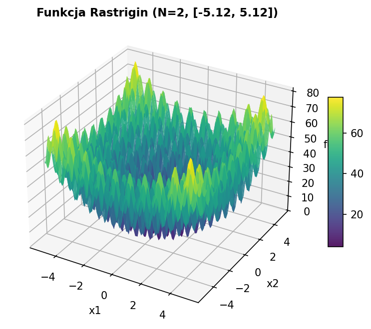
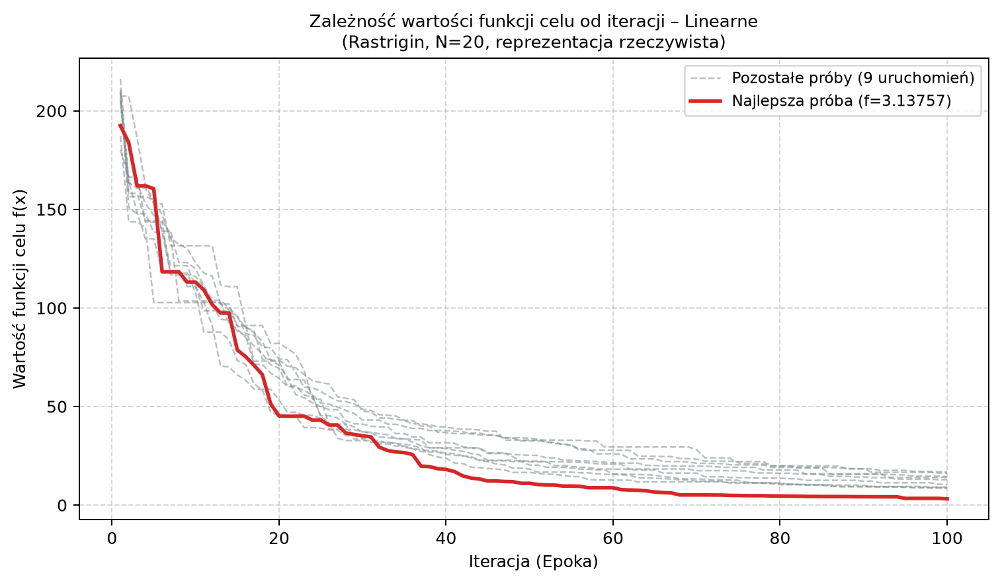
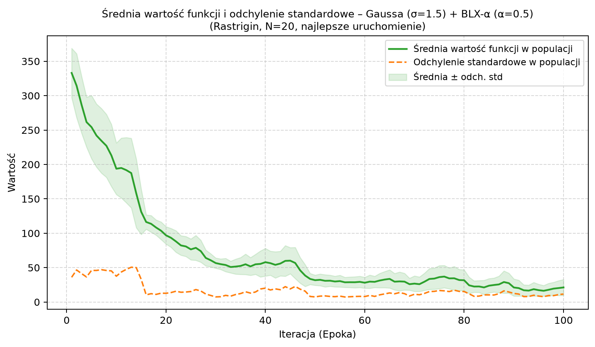
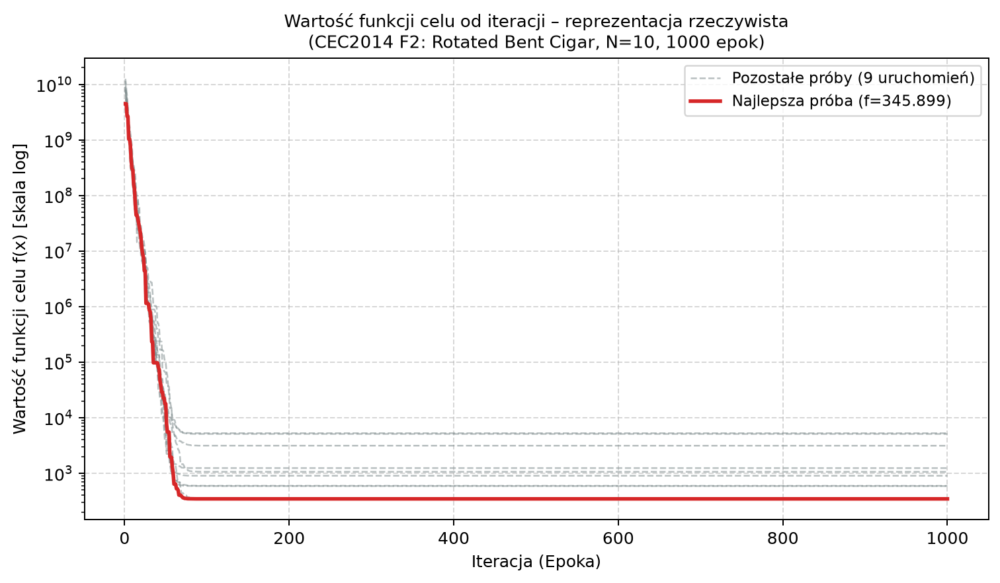
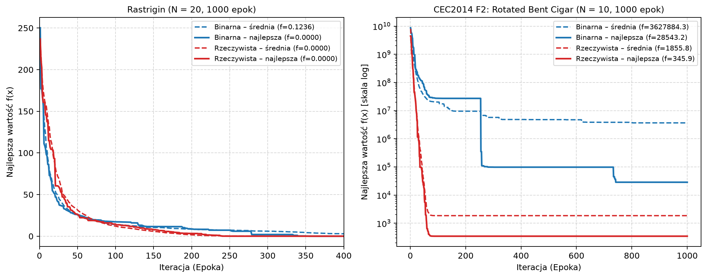

# Projekt 2 – Implementacja chromosomu rzeczywistego

**Przedmiot:** Obliczenia Ewolucyjne  
**Skład zespołu (grupa 2-osobowa):**  

1. Paweł Czernecki  
2. Michał Hacaś

**Data wykonania:** Listopad 2026

---

## 1. Informacje o wykorzystywanych technologiach

Projekt stanowi rozszerzenie aplikacji z Projektu 1, zrealizowane w paradygmacie obiektowym w języku **Python**, z zachowaniem separacji pomiędzy warstwą silnika ewolucyjnego (`engine/`) a warstwą interfejsu graficznego (`gui/`). Silnik został rozbudowany o obsługę **reprezentacji rzeczywistej** chromosomu, pięć ciągłych operatorów krzyżowania, dwie ciągłe metody mutacji oraz dynamiczne przełączanie między reprezentacją rzeczywistą i binarną w GUI.

* **Język programowania:** Python 3.10+ (środowisko testowe: Python 3.14.10).
* **Interfejs graficzny (GUI):** `Tkinter` oraz `ttk` (wielowątkowe wykonywanie obliczeń z paskiem postępu, automatyczne filtrowanie operatorów pod wybraną reprezentację oraz dynamiczna konfiguracja parametrów $\alpha$, $\beta$ i $\sigma$).
* **Wizualizacja wykresów:** `matplotlib` (wersja `3.11.2`) – wykresy osadzone w GUI (`FigureCanvasTkAgg`, `NavigationToolbar2Tk`) oraz eksport wykresów PNG.
* **Biblioteki obliczeniowe:**
    * `numpy` (wersja `2.5.5`) – operacje wektorowe i macierzowe przy ewaluacji funkcji celu.
    * `scipy` (wersja `1.18.1`) – wymagana zależność wewnętrzna biblioteki `benchmark_functions`.
* **Biblioteki funkcji testowych:**
    * `benchmark_functions` (wersja `1.1.4`) – wielowymiarowe funkcje ciągłe (*Hypersphere*, *Ackley*, *Rastrigin*).
    * `opfunu` (wersja `1.0.1`, wymaga `setuptools<81`) – oficjalny pakiet benchmarków IEEE CEC 2014 (*F2: Rotated Bent Cigar Function*).
* **Zapis danych i serializacja:** standardowe moduły `csv` oraz `json` (zapis konfiguracji, w tym typu reprezentacji, oraz przebiegu wszystkich epok do katalogu `results/`).

---

## 2. Wymagania środowiska i instrukcja uruchomienia

### 2.1. Wymagania systemowe

* System operacyjny: Linux (Fedora / Ubuntu / Debian)
* Zainstalowany interpreter: Python $\ge 3.10$ wraz z obsługą `venv` oraz pakietem systemowym `tkinter` do uruchamiania GUI (`python3-tkinter` na Fedora/RHEL lub `python3-tk` na Ubuntu/Debian).

### 2.2. Zestawienie bibliotek i zależności
Wszystkie zależności zewnętrzne zdefiniowano w pliku `requirements.txt`:

| Biblioteka | Wersja minimalna / testowana | Rola w projekcie |
| :--- | :---: | :--- |
| `numpy` | `>=1.24.0` (`2.5.5`) | Operacje numeryczne i tablicowe na wektorach decyzyjnych |
| `scipy` | `>=1.10.0` (`1.18.1`) | Zależność wymagana przez moduł `benchmark_functions` |
| `matplotlib` | `>=3.7.0` (`3.11.2`) | Generowanie i osadzanie wykresów zbieżności w GUI |
| `setuptools` | `<81` (`80.10.2`) | Dostarcza `pkg_resources` wymagane przez `opfunu` |
| `benchmark_functions` | `>=1.1.3` (`1.1.4`) | Implementacja funkcji Hypersphere, Ackley, Rastrigin |
| `opfunu` | `>=1.0.0` (`1.0.1`) | Implementacja funkcji CEC 2014 (F2 Bent Cigar) |

Instalacja środowiska i zależności:
```bash
python3 -m venv venv
source venv/bin/activate
pip install -r requirements.txt
```

### 2.3. Uruchomienie aplikacji
Uruchomienie interfejsu graficznego (GUI):
```bash
venv/bin/python main.py
```

Uruchomienie demonstracyjnego trybu konsolowego oraz testów jednostkowych:
```bash
venv/bin/python main.py --cli
PYTHONPATH=. venv/bin/python -m unittest discover -s tests -v
```

---

## 3. Wybrane funkcje testowe i implementacja reprezentacji rzeczywistej

### 3.1. Funkcje testowe wykorzystane w badaniach

Do oceny skuteczności reprezentacji rzeczywistej oraz porównania jej z reprezentacją binarną z Projektu 1 wykorzystano te same dwie funkcje testowe o odmiennej charakterystyce:

#### Funkcja 1: Rastrigin [benchmark_functions]

* **Wzór matematyczny:**
  $$f(x) = 10 \cdot N + \sum_{i=1}^N \left( x_i^2 - 10 \cos(2\pi x_i) \right)$$

* **Dziedzina poszukiwań:** $x_i \in [-5.12, 5.12]$ dla każdego $i \in \{1, \dots, N\}$
* **Charakterystyka:** funkcja silnie wielomodalna (*highly multimodal*), nieliniowa, posiadająca gęstą sieć minimów lokalnych rozmieszczonych w regularnych odstępach co $\approx 1.0$. Głównym wyzwaniem jest uniknięcie przedwczesnego utknięcia w lokalnych minimach.
* **Rysunek poglądowy funkcji:**  
    
  *Wykres 3D powierzchni funkcji Rastrigin dla przestrzeni dwuwymiarowej ($N = 2$).*
* **Teoretyczne minimum globalne:** $f^* = 0.0$ w punkcie $x^* = [0.0, \dots, 0.0]$.

#### Funkcja 2: CEC2014 F2 (Rotated Bent Cigar Function)

* **Wzór matematyczny:**
  $$f(x) = z_1^2 + 10^6 \sum_{i=2}^N z_i^2 + f_{\text{bias}}, \quad z = M \cdot (x - o)$$
  gdzie $M$ to macierz obrotu, $o$ to wektor przesunięcia, a $f_{\text{bias}} = 200.0$.

* **Dziedzina poszukiwań:** $x_i \in [-100.0, 100.0]$
* **Charakterystyka:** funkcja przesunięta i obrócona o bardzo wąskiej, stromej grani (*narrow ridge*) i silnym złym uwarunkowaniu ($10^6$ na składowych $z_2, \dots, z_N$). Wymaga precyzyjnego, ciągłego dostrajania wszystkich współrzędnych jednocześnie.
* **Rysunek poglądowy funkcji:**  
    
  *Wykres 3D powierzchni funkcji Bent Cigar dla przestrzeni dwuwymiarowej ($N = 2$).*
* **Teoretyczne minimum globalne:** $f^* = 200.0$ w punkcie $x^* = o_2$ (dla $N = 10$: `[-54.050831, 47.085527, -30.205593, 4.565302, -53.496203, 16.317111, -37.924594, 24.652656, 30.274321, 39.704255]`).

---

### 3.2. Reprezentacja rzeczywista oraz zaimplementowane operatory

W klasie `Chromosome` (`engine/chromosome.py`) w trybie `representation="real"` osobnik reprezentowany jest bezpośrednio jako wektor $N$ liczb zmiennoprzecinkowych $x = [x_1, x_2, \dots, x_N]$, bez konwersji binarnej i błędów kwantyzacji. Po każdym operatorze genetycznym wartości są przycinane (`_clamp`) do granic dziedziny $[a_i, b_i]$.

* **Zaimplementowane operatory krzyżowania rzeczywistego (`engine/crossover.py`):**
    1. **Arytmetyczne (`arithmetic_crossover`):** dla losowego $k \in [0, 1]$ tworzy parę potomków jako kombinację wypukłą rodziców:
       $$y_i^{(1)} = k x_i^{(1)} + (1 - k) x_i^{(2)}, \quad y_i^{(2)} = (1 - k) x_i^{(1)} + k x_i^{(2)}$$
    2. **Linearne (`linear_crossover`, Wright 1991):** z pary rodziców generuje trzech kandydatów ($Z$ uśredniony oraz $V, W$ eksploracyjne poza odcinek łączący rodziców):
       $$Z_i = 0.5 x_i^{(1)} + 0.5 x_i^{(2)}$$
       $$V_i = 1.5 x_i^{(1)} - 0.5 x_i^{(2)}, \quad W_i = -0.5 x_i^{(1)} + 1.5 x_i^{(2)}$$
       a następnie ocenia wszystkie trzy wektory funkcją celu i wybiera **dwa najlepsze** osobniki do nowej populacji.
    3. **Mieszające typu $\alpha$ (`blx_alpha`, BLX-$\alpha$):** dla każdego genu $d_i = |x_i^{(1)} - x_i^{(2)}|$ losuje wartości potomków z rozkładu jednostajnego na rozszerzonym symetrycznie przedziale:
       $$y_i \sim \mathcal{U}\big(\min(x_i^{(1)}, x_i^{(2)}) - \alpha d_i,\; \max(x_i^{(1)}, x_i^{(2)}) + \alpha d_i\big)$$
    4. **Mieszające typu $\alpha$ i $\beta$ (`blx_alpha_beta`, BLX-$\alpha\beta$):** asymetryczne uogólnienie BLX-$\alpha$ z niezależnymi współczynnikami rozszerzenia dolnego ($\alpha$) i górnego ($\beta$):
       $$y_i \sim \mathcal{U}\big(\min(x_i^{(1)}, x_i^{(2)}) - \alpha d_i,\; \max(x_i^{(1)}, x_i^{(2)}) + \beta d_i\big)$$
    5. **Uśredniające (`average_crossover`):** wyznacza punkt środkowy między rodzicami:
       $$y_i = \frac{x_i^{(1)} + x_i^{(2)}}{2}$$

* **Zaimplementowane operatory mutacji rzeczywistej (`engine/mutation.py`):**
    1. **Mutacja równomierna (`uniform_mutation`):** losuje indeks zmiennej $i$ i zastępuje jej wartość nową liczbą z rozkładu jednostajnego $x_i' \sim \mathcal{U}(a_i, b_i)$.
    2. **Mutacja Gaussa (`gaussian_mutation`):** dodaje do losowej współrzędnej zaburzenie z rozkładu normalnego o średniej $0$ i zadanym odchyleniu $\sigma$ (domyślnie $\sigma = 0.1 \cdot (b_i - a_i)$):
       $$x_i' = \min\big(b_i,\; \max(a_i,\; x_i + \mathcal{N}(0, \sigma))\big)$$

---

## 4. Metodologia badawcza i plan eksperymentów

Każda badana konfiguracja algorytmu została uruchomiona **10 razy** z ustalonymi ziarnami losowości w celu zapewnienia powtarzalności i porównywalności pomiarów na tym samym środowisku sprzętowym.

Dla każdej serii wyznaczono:

* **Średnią wartość** funkcji celu z 10 uruchomień ($\bar{f}$),
* **Najlepszy wynik** z 10 uruchomień ($f_{\min}$),
* **Najgorszy wynik** z 10 uruchomień ($f_{\max}$),
* **Odchylenie standardowe** pomiędzy uruchomieniami ($\sigma_{\text{serii}}$),
* **Średni czas obliczeń** pojedynczego przebiegu [s].

Wykresy przebiegu ewolucji przedstawiają zależność wartości funkcji celu od kolejnej iteracji (najlepsza próba na tle pozostałych 9 uruchomień) oraz przebieg średniej wartości funkcji celu i odchylenia standardowego wewnątrz populacji dla najlepszego uruchomienia w danej serii.

---

## 5. Wyniki eksperymentów dla reprezentacji rzeczywistej

### 5.1. Eksperyment 1: Wpływ metody krzyżowania rzeczywistego

* **Stałe parametry:** Funkcja: Rastrigin, $N = 20$, Reprezentacja: Rzeczywista, Populacja = 80, Epoki = 100, Selekcja: Turniejowa ($k = 3$), Mutacja: Gaussa ($p_m = 0.30, \sigma = 0.5$), Elitaryzm = 10%, $p_c = 0.80$.

| Metoda krzyżowania | $p_c$ | Średnia $f(x)$ | Najlepszy wynik | Najgorszy wynik | Odch. std serii | Śr. czas [s] |
| :--- | :---: | :---: | :---: | :---: | :---: | :---: |
| **Arytmetyczne** | 0.8 | 19.113899 | 5.879955 | 32.809893 | 8.022653 | 0.1428 |
| **Linearne** | 0.8 | **11.410645** | **3.137567** | **16.717091** | **3.984448** | 0.2086 |
| **Mieszające typu alfa (BLX-$\alpha$, $\alpha=0.5$)** | 0.8 | 24.041170 | 12.536232 | 34.064169 | 6.101933 | 0.1627 |
| **Mieszające typu $\alpha$ i $\beta$ (BLX-$\alpha\beta$, $0.5, 0.25$)** | 0.8 | 22.834877 | 14.090566 | 35.811014 | 5.757205 | 0.1627 |
| **Uśredniające** | 0.8 | 16.157683 | 9.608655 | 23.323641 | 4.288544 | **0.1269** |

#### Wykresy z najlepszej serii (Krzyżowanie linearne, $f_{\min} = 3.137567$):
  
*Rysunek 1: Zależność wartości funkcji celu od kolejnej iteracji dla najlepszej serii w Eksperymencie 1 (krzyżowanie linearne). Linia ciągła czerwona oznacza najlepsze uruchomienie, a linie przerywane – pozostałe 9 prób.*

  
*Rysunek 2: Średnia wartość funkcji celu oraz odchylenie standardowe wewnątrz populacji w kolejnych iteracjach dla najlepszego uruchomienia z krzyżowaniem linearnym.*

#### Komentarz do wyników:

1. **Najwyższa skuteczność krzyżowania linearnego:** Operator linearny osiągnął zdecydowanie najlepszą średnią ($11.41$), najniższe minimum ($3.14$) oraz najniższe odchylenie standardowe serii ($3.98$). Wynika to z faktu, że w każdej parze rodziców bada trzy punkty ($Z, V, W$) i zatrzymuje dwa najlepiej ocenione przez funkcję celu, co wprowadza kierunkową presję lokalnego przeszukiwania.
2. **Koszt czasowy oceny dodatkowych kandydatów:** Krzyżowanie linearne było o około $30\text{–}60\%$ wolniejsze ($0.2086\text{ s}$) niż pozostałe operatory ($0.1269\text{–}0.1627\text{ s}$), ponieważ w momencie zajścia krzyżowania wymaga trzech ewaluacji funkcji celu zamiast dwóch. Najszybsze okazało się proste krzyżowanie uśredniające ($0.1269\text{ s}$).
3. **Zachowanie BLX-$\alpha$ i BLX-$\alpha\beta$ w krótkim budżecie epok:** Przy zaledwie $100$ epokach szerokie przedziały mieszania ($\alpha = 0.5$) silnie podtrzymują różnorodność i spowalniają dogęszczanie populacji wokół minimum (średnia $24.04$ dla BLX-$\alpha$ i $22.83$ dla BLX-$\alpha\beta$), podczas gdy krzyżowanie uśredniające ($16.16$) i arytmetyczne ($19.11$) szybciej ściągają wektory do centrum populacji.

---

### 5.2. Eksperyment 2: Wpływ metody mutacji oraz parametrów $\sigma$, $\alpha$ i $\beta$

* **Stałe parametry:** Funkcja: Rastrigin, $N = 20$, Reprezentacja: Rzeczywista, Populacja = 80, Epoki = 100, Selekcja: Turniejowa ($k = 3$), Elitaryzm = 10%, $p_c = 0.80$, $p_m = 0.30$.

| Konfiguracja mutacji i parametrów krzyżowania | Średnia $f(x)$ | Najlepszy wynik | Najgorszy wynik | Odch. std serii | Śr. czas [s] |
| :--- | :---: | :---: | :---: | :---: | :---: |
| **Mutacja równomierna + BLX-$\alpha$ ($\alpha=0.5$)** | 15.039189 | **8.493700** | 21.620620 | 3.781890 | **0.1591** |
| **Mutacja Gaussa ($\sigma=0.1$) + BLX-$\alpha$ ($\alpha=0.5$)** | 32.354820 | 12.949786 | 54.725794 | 12.124144 | 0.1661 |
| **Mutacja Gaussa ($\sigma=0.5$) + BLX-$\alpha$ ($\alpha=0.5$)** | 24.041170 | 12.536232 | 34.064169 | 6.101933 | 0.1622 |
| **Mutacja Gaussa ($\sigma=1.5$) + BLX-$\alpha$ ($\alpha=0.5$)** | **13.836396** | 10.395731 | **20.572631** | **3.486069** | 0.1621 |
| **Mutacja Gaussa ($\sigma=0.5$) + BLX-$\alpha$ ($\alpha=0.25$)** | 16.629337 | 9.662555 | 40.285106 | 8.723628 | 0.1623 |
| **Mutacja Gaussa ($\sigma=0.5$) + BLX-$\alpha\beta$ ($\alpha=0.5, \beta=0.25$)** | 22.834877 | 14.090566 | 35.811014 | 5.757205 | 0.1619 |

#### Wykresy z najlepszej konfiguracji (Mutacja Gaussa $\sigma = 1.5$ + BLX-$\alpha$ $\alpha = 0.5$):
  
*Rysunek 3: Wartość funkcji celu od iteracji dla najlepszej serii w Eksperymencie 2 (Mutacja Gaussa $\sigma=1.5$ + BLX-$\alpha$ $\alpha=0.5$).*

  
*Rysunek 4: Średnia wartość funkcji celu oraz odchylenie standardowe w populacji dla najlepszego uruchomienia w Eksperymencie 2.*

#### Komentarz do wyników:

1. **Kluczowy wpływ odchylenia $\sigma$ w mutacji Gaussa:** Odległość między sąsiednimi minimami lokalnymi funkcji Rastrigin wynosi $1.0$. Zbyt małe zaburzenie ($\sigma = 0.1$) nie pozwala osobnikom przeskakiwać barier potencjału pomiędzy sąsiednimi dolinami, przez co algorytm utyka w pułapkach lokalnych (średnia aż $32.35$, odchylenie $12.12$). Zwiększenie odchylenia do $\sigma = 1.5$ ($\approx 15\%$ szerokości przedziału $[-5.12, 5.12]$) poprawia średni wynik ponad dwukrotnie – do **$13.84$** przy najmniejszym rozrzucie ($\sigma_{\text{serii}} = 3.49$).
2. **Mutacja równomierna vs mutacja Gaussa:** Mutacja równomierna uzyskała najlepszy pojedynczy wynik w tej serii ($8.49$) i drugą najniższą średnią ($15.04$), ponieważ losowanie nowej wartości z całego przedziału $[-5.12, 5.12]$ skutecznie przełamuje przedwczesną zbieżność na funkcji wielomodalnej. Mutacja Gaussa z odpowiednio dobranym $\sigma = 1.5$ osiąga jednak lepszą średnią i stabilność, ponieważ dominują w niej umiarkowane skoki wokół aktualnych rozwiązań.
3. **Wpływ parametrów $\alpha$ i $\beta$ w krzyżowaniu mieszającym:** Zmniejszenie $\alpha$ z $0.5$ do $0.25$ w BLX-$\alpha$ poprawiło średnią z $24.04$ do $16.63$, ograniczając nadmierną ekspansję poza obszar zajmowany przez rodziców w krótkim przebiegu $100$ epok. Asymetryczny wariant BLX-$\alpha\beta$ ($\alpha=0.5, \beta=0.25$) również okazał się nieco lepszy średnio ($22.83$) niż symetryczne BLX-$\alpha$ ($24.04$). Czasy obliczeń wszystkich konfiguracji były praktycznie identyczne ($\approx 0.16\text{ s}$).

---

### 5.3. Eksperyment 3: Wpływ metody selekcji w reprezentacji rzeczywistej

* **Stałe parametry:** Funkcja: Rastrigin, $N = 20$, Reprezentacja: Rzeczywista, Populacja = 80, Epoki = 100, Krzyżowanie: BLX-$\alpha$ ($p_c = 0.80, \alpha = 0.5$), Mutacja: Gaussa ($p_m = 0.30, \sigma = 0.5$), Elitaryzm = 10%.

| Metoda selekcji | Parametr selekcji | Średnia $f(x)$ | Najlepszy wynik | Najgorszy wynik | Odch. std serii | Śr. czas [s] |
| :--- | :---: | :---: | :---: | :---: | :---: | :---: |
| **Najlepszych (Truncation)** | pula = 10% | **14.987155** | **6.112598** | **25.272750** | 6.498559 | 0.1785 |
| **Najlepszych (Truncation)** | pula = 50% | 18.244020 | 11.010597 | 26.729189 | **5.176333** | 0.1799 |
| **Turniejowa** | $k = 7$ | 21.917703 | 6.425687 | 35.787541 | 9.923401 | 0.1794 |
| **Turniejowa** | $k = 3$ | 24.041170 | 12.536232 | 34.064169 | 6.101933 | **0.1671** |
| **Koło ruletki** | — | 31.960454 | 15.309827 | 42.865444 | 8.375305 | 0.2112 |
| *Najgorszych (kontrola)* | pula = 50% | *245.622693* | *187.361474* | *277.074869* | *22.805797* | *0.1826* |

#### Komentarz do wyników:

1. **Równowaga presji selekcyjnej i eksploracji BLX-$\alpha$:** Ponieważ operator BLX-$\alpha$ ($\alpha=0.5$) silnie poszerza przestrzeń przeszukiwań, wyższa presja selekcyjna w selekcji najlepszych (pula $10\%$, średnia $14.99$; pula $50\%$, średnia $18.24$) pozwoliła szybciej wykorzystywać obiecujące obszary niż turniej $k=3$ ($24.04$).
2. **Stabilność vs losowość selekcji:** Selekcja najlepszych ($50\%$) wykazała najniższy rozrzut między próbami ($\sigma_{\text{serii}} = 5.18$), natomiast duży turniej ($k = 7$) przy wysokim najlepszym wyniku ($6.43$) cechował się większą wariancją ($\sigma_{\text{serii}} = 9.92$). Koło ruletki okazało się najsłabszą i najwolniejszą ($0.2112\text{ s}$) spośród metod maksymalizujących dopasowanie, a próba kontrolna z selekcją najgorszych ($245.62$) potwierdziła poprawność kierunku selekcji.

---

## 6. Porównanie reprezentacji klasycznej (binarnej) oraz rzeczywistej

W Eksperymencie 4 porównano bezpośrednio obie reprezentacje na tym samym środowisku sprzętowo-programowym przy identycznym budżecie ewaluacji (Populacja = $200$, Epoki = $1000$, Selekcja turniejowa $k = 3$, Elitaryzm = $10\%$, $p_c = 0.80$, $p_m = 0.30$, $10$ uruchomień) dla wymiarów $N \in \{10, 20, 30\}$ na funkcjach **Rastrigin** oraz **CEC2014 F2: Rotated Bent Cigar**:

* **Reprezentacja rzeczywista:** Krzyżowanie BLX-$\alpha$ ($\alpha = 0.5$), Mutacja Gaussa ($\sigma = 0.1 \cdot (b - a)$, tzn. $\sigma \approx 1.024$ dla Rastrigin oraz $\sigma = 20.0$ dla CEC2014 F2), brak inwersji.
* **Reprezentacja binarna:** $20$ bitów na zmienną (długość chromosomu $200, 400, 600$ bitów), Krzyżowanie dwupunktowe, Mutacja jednopunktowa, Inwersja ($p_i = 0.30$).

### 6.1. Wyniki dla funkcji Rastrigin ($f^* = 0.0$)

| Wymiar $N$ | Reprezentacja | Średnia $f(x)$ | Najlepszy $f(x)$ | Najgorszy $f(x)$ | Odch. std ($\sigma$) | Śr. czas [s] |
| :---: | :--- | :---: | :---: | :---: | :---: | :---: |
| **$N = 10$** | **Rzeczywista** | **0.000000** | **0.000000** | **0.000000** | **0.000000** | **2.64 s** |
| **$N = 10$** | Binarna (200 bitów) | 0.000000 | 0.000000 | 0.000000 | 0.000000 | 4.64 s |
| **$N = 20$** | **Rzeczywista** | **0.000000** | **0.000000** | **0.000000** | **0.000000** | **3.88 s** |
| **$N = 20$** | Binarna (400 bitów) | 0.123582 | 0.000000 | 1.235823 | 0.370747 | 7.49 s |
| **$N = 30$** | **Rzeczywista** | **0.000054** | **0.000000** | **0.000402** | **0.000120** | **5.35 s** |
| **$N = 30$** | Binarna (600 bitów) | 0.646703 | 0.000000 | 2.230782 | 0.852733 | 10.71 s |

### 6.2. Wyniki dla funkcji CEC2014 F2: Rotated Bent Cigar ($f^* = 200.0$)

| Wymiar $N$ | Reprezentacja | Średnia $f(x)$ | Najlepszy $f(x)$ | Najgorszy $f(x)$ | Odch. std ($\sigma$) | Śr. czas [s] |
| :---: | :--- | :---: | :---: | :---: | :---: | :---: |
| **$N = 10$** | **Rzeczywista** | **1 855.85** | **345.90** | **5 251.28** | **1 826.19** | **3.68 s** |
| **$N = 10$** | Binarna (200 bitów) | 3 627 884.28 | 28 543.16 | 16 797 938.84 | 5 593 199.88 | 5.90 s |
| **$N = 20$** | **Rzeczywista** | **200.00** | **200.00** | **200.00** | **0.00** | **4.43 s** |
| **$N = 20$** | Binarna (400 bitów) | 26 089 147.32 | 1 454 067.56 | 59 788 246.72 | 17 463 934.38 | 8.37 s |
| **$N = 30$** | **Rzeczywista** | **10 482.29** | **220.47** | **29 576.25** | **10 009.37** | **5.42 s** |
| **$N = 30$** | Binarna (600 bitów) | 92 547 064.38 | 2 930 342.63 | 324 098 290.08 | 90 240 243.14 | 10.91 s |

#### Wykresy zbieżności dla CEC2014 F2 ($N = 10$, reprezentacja rzeczywista, $f_{\min} = 345.90$):
  
*Rysunek 5: Wartość funkcji celu od iteracji dla funkcji CEC2014 F2 ($N = 10$) w reprezentacji rzeczywistej (linia ciągła czerwona – próba najlepsza, linie przerywane – pozostałe 9 uruchomień, skala logarytmiczna).*

  
*Rysunek 6: Średnia wartość funkcji celu oraz odchylenie standardowe w populacji dla najlepszego uruchomienia na funkcji CEC2014 F2 ($N = 10$, skala logarytmiczna).*

#### Bezpośrednie porównanie krzywych zbieżności obu reprezentacji:
  
*Rysunek 7: Zestawienie krzywych zbieżności reprezentacji rzeczywistej i binarnej dla funkcji Rastrigin ($N = 20$, widok do epoki 400) oraz CEC2014 F2 ($N = 10$, skala logarytmiczna).*

---

### 6.3. Zestawienie zbiorcze błędów i czasu obliczeń

| Funkcja testowa | $N$ | Optimum $f^*$ | Błąd najlepszy<br>$\|f^* - f_{\min}\|$ (Rzecz.) | Błąd najlepszy<br>$\|f^* - f_{\min}\|$ (Bin.) | Błąd średni<br>$\|f^* - \bar{f}\|$ (Rzecz.) | Błąd średni<br>$\|f^* - \bar{f}\|$ (Bin.) | Przyspieszenie czasu (Bin. / Rzecz.) |
| :--- | :---: | :---: | :---: | :---: | :---: | :---: | :---: |
| **Rastrigin** | 10 | $0.0$ | **$0.00 \cdot 10^0$** | $4.73 \cdot 10^{-8}$ | **$0.00 \cdot 10^0$** | $4.73 \cdot 10^{-8}$ | $1.75\times$ |
| **Rastrigin** | 20 | $0.0$ | **$0.00 \cdot 10^0$** | $9.46 \cdot 10^{-8}$ | **$1.47 \cdot 10^{-8}$** | $0.123582$ | $1.93\times$ |
| **Rastrigin** | 30 | $0.0$ | **$0.00 \cdot 10^0$** | $1.42 \cdot 10^{-7}$ | **$5.37 \cdot 10^{-5}$** | $0.646703$ | $2.00\times$ |
| **CEC2014 F2** | 10 | $200.0$ | **$145.90$** | $28\,343.16$ | **$1\,655.85$** | $3\,627\,684.28$ | $1.60\times$ |
| **CEC2014 F2** | 20 | $200.0$ | **$0.00$** | $1\,453\,867.56$ | **$0.00$** | $26\,088\,947.32$ | $1.89\times$ |
| **CEC2014 F2** | 30 | $200.0$ | **$20.47$** | $2\,930\,142.63$ | **$10\,282.29$** | $92\,546\,864.38$ | $2.01\times$ |

#### Analiza porównawcza:

1. **Przewaga dokładności na funkcji wielomodalnej (Rastrigin):**  
   Choć najlepsze pojedyncze uruchomienia reprezentacji binarnej również trafiały w okolicę minimum globalnego ($0.0$), to w wymiarach $N = 20$ i $N = 30$ część prób binarnych zatrzymywała się w sąsiednim minimum lokalnym ($f \approx 1.24$ i $2.23$, średnie błędy $0.124$ oraz $0.647$). Reprezentacja rzeczywista osiągnęła $100\%$ powtarzalności dla $N = 10$ i $N = 20$ (błąd średni $\le 1.47 \cdot 10^{-8}$) oraz błąd średni zaledwie $5.37 \cdot 10^{-5}$ dla $N = 30$, bez ograniczeń siatki kwantyzacji.

2. **Przełomowa poprawa na silnie uwarunkowanej funkcji CEC2014 F2:**  
   W zadaniu *Rotated Bent Cigar* zmiana reprezentacji przyniosła poprawę o **3 do 6 rzędów wielkości**. Przy $N = 10$ błąd średni spadł z $3.63 \cdot 10^6$ (binarna) do $1.66 \cdot 10^3$ (rzeczywista), a przy $N = 30$ z $9.25 \cdot 10^7$ do $1.03 \cdot 10^4$ (najlepszy wynik $220.47$, czyli błąd zaledwie $20.47$ wobec $2.93 \cdot 10^6$ w wersji binarnej!). W wymiarze $N = 20$, w którym macierz obrotu CEC2014 F2 zawiera większy udział osiowo wyrównanych składowych przekątnych, operator BLX-$\alpha$ odnalazł dokładne optimum $f^* = 200.0$ we wszystkich 10 próbach.

3. **Dwukrotne przyspieszenie obliczeń:**  
   Reprezentacja rzeczywista okazała się systematycznie szybsza od binarnej – w wymiarze $N = 10$ o $1.60\times\text{–}1.75\times$, a dla $N = 30$ dokładnie **$2.00\times$ szybciej** ($5.35\text{ s}$ wobec $10.71\text{ s}$ na Rastrigin oraz $5.42\text{ s}$ wobec $10.91\text{ s}$ na CEC2014 F2). Eliminacja konwersji ciągów 600 bitów na liczby zmiennoprzecinkowe w każdej epoce oraz rezygnacja z operatora inwersji znacząco obniżają narzut obliczeniowy silnika.

---

## 7. Wnioski końcowe

1. **Przewaga reprezentacji rzeczywistej w optymalizacji ciągłej:**  
   Zastąpienie kodowania binarnego wektorem liczb zmiennoprzecinkowych eliminuje błędy dyskretyzacji oraz problem tzw. klifów Hamminga (gdzie zmiana pojedynczego bitu skokowo przemieszcza rozwiązanie). Pozwala to algorytmowi genetycznemu precyzyjnie poruszać się wzdłuż wąskich dolin funkcji silnie uwarunkowanych (CEC2014 F2) oraz osiągać wyższą powtarzalność na funkcjach wielomodalnych (Rastrigin).

2. **Znacząca poprawa wydajności czasowej:**  
   Brak konieczności dekodowania długich chromosomów binarnych ($200\text{–}600$ bitów) oraz brak inwersji skraca czas obliczeń o $37\%\text{–}50\%$ (do $2\times$ szybciej dla $N = 30$), co zwiększa opłacalność obliczeń dla wysokich wymiarów problemu.

3. **Dobór operatorów ciągłych i ich parametrów:**
   * **Krzyżowanie:** W krótkim horyzoncie czasowym ($100$ epok) najlepiej spisało się **krzyżowanie linearne** dzięki selekcji 2 najlepszych spośród 3 kandydatów. W długich przebiegach ($1000$ epok) na złożonych funkcjach obróconych bardzo dobrze sprawdziło się **krzyżowanie BLX-$\alpha$**, które stale podtrzymuje eksplorację przestrzeni.
   * **Mutacja:** Kluczowy wpływ ma dopasowanie odchylenia $\sigma$ mutacji Gaussa do skali dziedziny i rozstawu minimów lokalnych (zbyt małe $\sigma = 0.1$ powoduje utykanie w minimach lokalnych, natomiast automatyczne $\sigma = 0.1 \cdot (b - a)$ lub $\sigma = 1.5$ zapewnia skuteczne przeskoki między dolinami). Mutacja równomierna stanowi dobrą alternatywę utrzymującą globalną eksplorację.
   * **Selekcja:** W reprezentacji rzeczywistej z operatorem BLX-$\alpha$ korzystne okazały się metody o wyższej presji selekcyjnej (selekcja najlepszych z pulą $10\%\text{–}50\%$), dobrze równoważące szerokie próbkowanie potomstwa przez krzyżowanie mieszające.
